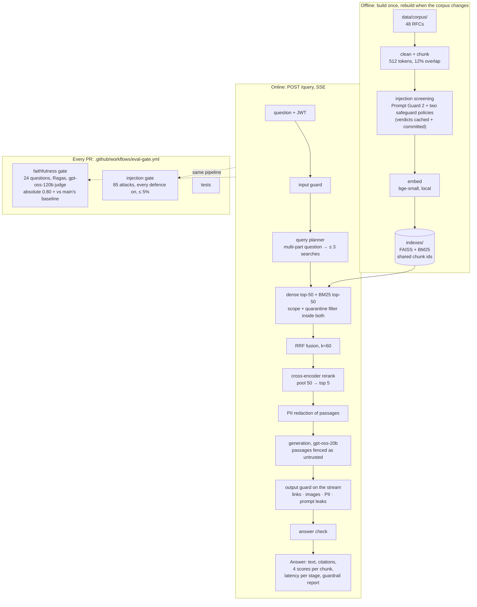
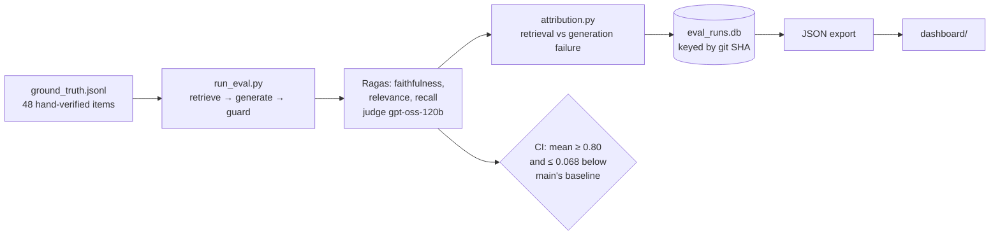

# Sentinel — Architecture

How the system is put together, as built. For the measured results see the
[README](README.md#results); for the original planning-stage design see
[`docs/architecture.md`](docs/architecture.md).

Sentinel is a question-answering service over 48 IETF RFCs with two jobs: answer from the
retrieved text and cite it, and **prove on every pull request** that it still does — that
answers stay grounded, and that instructions planted in documents or questions don't get through.

---

## 1. The system at a glance

Three properties hold throughout:

- **The eval measures what ships.** The faithfulness gate and the injection gate drive the same
  retrieval, prompt and guardrail code the service uses; there's no separate "eval mode" path.
- **Every number is attributable.** An answer records its retrieved chunks, all four scores per
  chunk and per-stage latency; an eval run records its git SHA; an index records its chunking.
- **Untrusted text is handled as data.** The question, the passages and the generated answer
  each have a guardrail placed where that text enters or leaves (section 4).

---

## 2. Query path

| Stage | Module | What it does | Why this way |
|---|---|---|---|
| Auth + rate limit | [`serve.py`](sentinel/serve.py), [`users.py`](sentinel/users.py) | JWT bearer with document scopes, issued from a user store (scrypt hashes); slowapi limit per named account, per IP for the shared demo account and sign-in | Scopes come from the signed token, never the request, and every token is re-checked against its account |
| Input guard | [`guardrails/input.py`](sentinel/guardrails/input.py) | gpt-oss-safeguard-20b with an input policy; a flagged question gets a fixed refusal | Chosen over Prompt Guard by measurement: it refused 0 of 88 genuine questions, Prompt Guard 2 |
| Semantic cache (on by default) | [`cache.py`](sentinel/cache.py) | after the input guard: a question with the same technical tokens and embedding similarity ≥ 0.98 to an earlier one, in the same context (scopes, index build, models, prompt, retrieval and guard settings), replays its answer | Skips retrieval, rerank, generation and the answer check. The threshold clears the most similar near-miss the token check can't see (0.966) by 0.01; 0 false hits on 29 near-misses and 1,128 ground-truth pairs (`data/cache_eval.json`). Only clean, cited answers are stored; a thumbs-down evicts |
| Query planning (on by default) | [`plan.py`](sentinel/plan.py) | one gpt-oss-20b call splits a multi-part question into up to 3 standalone searches; each is reranked on ceil(50 / n) candidates and the results are merged in turn, one from each search, into 6 passages. The answer is generated against the original question | A single search's top 5 fills up from one half of a two-part question (15 / 32 parts covered vs 22 / 32 planned). It fails open to the question as asked, and an unsplit question takes the ordinary path unchanged. The injection gate passed with it on, and both gates retrieve through it, as the service does |
| Dense + sparse | [`retrieve.py`](sentinel/retrieve.py) | FAISS (bge-small) top 50 and BM25 top 50 | BM25 recovers exact terms — header names, status codes — that dense misses |
| Access filter | `retrieve.Access` | scope and quarantine applied **inside** both searches (FAISS id selector or a pgvector `WHERE` clause; BM25 mask) | A post-filter would let a blocked chunk take a candidate slot or reach the reranker |
| Fusion | `rrf_fuse` | Reciprocal Rank Fusion, k = 60 | The two retrievers' scores aren't comparable; ranks are |
| Rerank | cross-encoder ms-marco-MiniLM-L-6-v2, local | scores the top 50 fused, keeps 5 | The dominant latency (~950 ms p50 on CPU); a measured pool of 20 is the fallback |
| PII redaction | [`guardrails/pii.py`](sentinel/guardrails/pii.py) | emails (not role/list mailboxes), phones, Luhn-valid cards, credentials, before the model sees them; outside the public scope also names (spaCy NER + name-shape check) and street addresses | RFC author blocks are real personal data; RFC author *names* are public record, a tenant's customers' are not |
| Generation | [`generate.py`](sentinel/generate.py) | gpt-oss-20b on Groq, streamed; passages fenced with a per-request random tag, rule repeated after them | A fixed fence can be forged by a passage; a random one can't |
| Output guard | [`guardrails/output.py`](sentinel/guardrails/output.py) | on the token stream: link allowlist (scheme-less too), images removed, PII, prompt-leak filter; citations checked at the end | Holds back a short tail so half a link never escapes; a property test proves stream = full-text result |
| Answer check | [`guardrails/answer.py`](sentinel/guardrails/answer.py) | safeguard model reads question + finished answer — never the passages — and withholds answers carrying out a planted instruction | The backup for an attack screening missed |

The answer is held until the answer check passes, then its tokens are sent after a `checking`
event, so a withheld answer never leaves the service. Words still stream, but the first one
arrives after generation and the check; the dashboard paces the released tokens. `answer_check_blocks=false` streams
instead, and the check can then only retract: the `done` event carries the replacement and a
`withheld` flag, which clients must honour (the dashboard does).

---

## 3. Offline: ingestion and the three indexes

[`ingest.py`](sentinel/ingest.py) cleans each RFC, splits it with LangChain's
`RecursiveCharacterTextSplitter` (512 tokens, 12% overlap), screens every chunk for injected
instructions, embeds locally and writes FAISS + BM25 over the **same chunk ids**, so fusion can
align them. Rebuilding is idempotent.

Screening runs here, not per query: the corpus is static, so a verdict computed once is reused
forever and costs the query path nothing. Verdicts are cached by chunk text in
`data/guardrails/screening_cache.jsonl` and committed — rebuilding an unchanged corpus, locally
or in CI, makes no API calls. Three detectors run: Prompt Guard 2, and the safeguard model under
two written policies (text addressing an AI; requests for an unrelated task or reply format). A
chunk flagged by any of them is **quarantined**: kept for audit, never retrieved. A classifier
reply that isn't a bare label also quarantines: a passage that can redirect the screener is an
injection by demonstration. Genuine RFC text a detector wrongly flags (3 of 2,888 chunks) is
released only by a reviewed exception in `data/guardrails/screening_exceptions.json`, pinned to
the exact text, its RFC and the detectors that flagged it, so an edit or a copy elsewhere is
screened again rather than inheriting the release.

| Index | Contents | Read by | Why separate |
|---|---|---|---|
| `indexes/` | the 48 RFCs | the service, the faithfulness eval | Nothing that reads it can ever see a poisoned chunk |
| `indexes_adversarial/` | the real index + 50 hand-written poisoned docs (scope `adversarial`) | the injection gate | Attacks need the real corpus around them to be realistic |
| `indexes_bipia/` | the real index + 75 [BIPIA](https://github.com/microsoft/BIPIA) attacks, one scope per attack | the independent attack run | Adding them to the adversarial index would shift BM25 statistics, and so results, for the other attack set |

All three are gitignored and rebuilt from committed sources; CI caches them by a hash of
everything that determines their contents.

---

## 4. Trust boundaries

Text from three places is untrusted, and each has its own control:

| Untrusted text | Threat | Control | Where |
|---|---|---|---|
| The user's question | jailbreaks, prompt extraction, personas, encoded payloads | input guard (refuse) | before retrieval |
| Retrieved passages | indirect injection: instructions planted in a document | screening at build (quarantine) → fencing + reminder in the prompt → output guard → answer check | index build, prompt, stream, end |
| The generated answer | exfiltration links, tracking images, PII, leaked prompt, obeyed instructions | output guard, answer check | stream, end |

Two design rules come from this table:

- **No classifier reads text it's guarding against unless it has to.** The answer check reads
  the answer, not the passages: a poisoned passage is written to manipulate whatever reads it.
- **Fail closed.** If the input guard or answer check can't reach its classifier, the request is
  refused or the answer withheld; the generator runs on the same provider, so an outage would
  fail the request anyway.

Scopes are the authorization model: every chunk has one, the JWT carries the caller's, and a
default-scope caller provably retrieves 0 adversarial chunks across every attack question.

Accounts grant the scopes ([`users.py`](sentinel/users.py)). The shared demo account's password
is public, so it only ever gets the default scope. Named accounts live in a JSON file of salted
scrypt hashes, managed with `scripts/users.py` and mounted in production from Secret Manager, so
it is never in the image or the repository. A caller may ask `/token` for fewer scopes than the
account has, never more. Each token carries a credential tag, an HMAC of the account's password
hash and scopes, and every request re-checks it against the store, which re-reads the file when
it changes. Disabling an account, changing its password or taking a scope away therefore ends its
existing tokens on the next request, with no database and no redeploy.

---

## 5. Evaluation and the gates

- **Faithfulness gate** — 24 of the 48 questions (faithfulness only; the other two metrics would
  triple judge spend without changing the verdict). Fails below 0.80, more than 0.068 below main's
  per-question baseline (`data/faithfulness_baseline.json`, always read from main), or on fewer
  than 18 scored items. The judge was chosen by calibration against hand labels, per host — the
  same model served elsewhere correlated far worse.
- **Injection gate** — the 50 document attacks and 35 question attacks with every defence on;
  fails if either set exceeds 5%. Success is a string check for unique canaries (Unicode-dash and
  zero-width blind), no judge.
- **Full reports run locally**: [`run_eval.py`](sentinel/eval/run_eval.py) (all 48, all three
  metrics), [`run_guardrails.py`](sentinel/eval/run_guardrails.py) (seven defence configurations
  × 3 repeats, exact Clopper–Pearson intervals), [`run_bipia.py`](sentinel/eval/run_bipia.py)
  (the independent set, judged), [`run_multistep.py`](sentinel/eval/run_multistep.py) (16
  two-part questions: per-part coverage against gold chunks whose evidence quotes are checked
  against the index, an over-splitting check on the 48 ordinary questions, and judged answers
  with planning on and off).
- **Path-filtered CI** — a `changes` job runs the paid gates only when code or gate data changed.

---

## 6. Models, where they run, and what they cost

| Role | Model | Runs |
|---|---|---|
| Embeddings | BAAI/bge-small-en-v1.5 | local, CPU |
| Rerank | cross-encoder/ms-marco-MiniLM-L-6-v2 | local, CPU |
| Generation | openai/gpt-oss-20b | Groq |
| Judge (eval, BIPIA) | openai/gpt-oss-120b | Groq |
| Input guard, screening policy, answer check | openai/gpt-oss-safeguard-20b | Groq |
| Screening detector | meta-llama/llama-prompt-guard-2-86m | Groq |

CPU over Apple MPS is a measured choice: MPS memory grew until long runs died, and CPU rerank
p95 was lower. The model factory ([`llm.py`](sentinel/llm.py)) is provider-agnostic — Groq,
OpenAI, DeepSeek, NVIDIA and Google are wired — but the judge is pinned to the host it was
calibrated on.

**Spend is metered and capped** ([`spend.py`](sentinel/spend.py)). Every Groq call records the
token counts the API returns, priced per model; with a limit set (`--max-spend`,
`SENTINEL_SPEND_LIMIT_USD`) the next call past it raises instead of being sent, and is never
retried. Each CI gate is capped at $0.25 and reports its actual cost.

---

## 7. Where LangChain is used, and where it isn't

Retrieval plumbing is a solved problem, so the framework handles it; the original work is in
tuning, measurement and the gates.

- **Used:** `RecursiveCharacterTextSplitter` for chunking; the dense and sparse stages are
  LangChain `BaseRetriever`s, composed with a real `EnsembleRetriever` (exercised in tests);
  chat models come through LangChain so generation and the Ragas judge share one factory.
- **Not used where it hides what we measure:** `EnsembleRetriever` fuses internally and doesn't
  expose per-retriever ranks and scores, so the served path computes RRF explicitly to keep all
  four scores per chunk. The optional query planner ([`plan.py`](sentinel/plan.py)) is one
  direct model call returning JSON, not an agent loop: it can only choose search queries, never
  tools or actions, and each query still runs the same inspectable pipeline.
- **Not used for the guardrail classifiers:** they call Groq's REST API directly
  ([`_groq.py`](sentinel/guardrails/_groq.py)), because Prompt Guard rejects the output-token
  budget the LangChain client sends on every call.

---

## 8. What's committed and what's rebuilt

| Committed (the audit trail) | Rebuilt or local only |
|---|---|
| corpus + manifest, ground truth, attack sets (hand-written and BIPIA, with its licence) | `indexes*/` |
| screening verdicts, answer-check verdicts | `eval_runs.db` |
| guardrail report with every recorded answer, faithfulness baseline, BIPIA report | `dashboard/data/*.json` (exported) |
| latency report, retrieval ablation, rerank pool sweep, judge calibration | `.env` (keys) |
| FAISS vs pgvector comparison | the local pgvector database (synced from `indexes*/`) |

Recorded answers are kept so a change to a success check can re-score history without new API
calls (`run_guardrails --rescore`).

---

## 9. Scaling and migration paths

Built for a fixed corpus and one demo tenant; the seams for growing it:

- **Vector store** — FAISS in-process in production; Postgres with pgvector behind
  `SENTINEL_VECTOR_STORE=pgvector` ([`vectorstore.py`](sentinel/vectorstore.py), local only for
  now). Dense search becomes one SQL query, with the scope and quarantine filters in its `WHERE`
  clause rather than applied afterwards. An HNSW index serves it, and pgvector's iterative scan keeps reading
  when the filters reject candidates, so the top 50 is never short. The index directory stays the
  build artifact. `python -m sentinel.vectorstore sync` copies it into a collection, and later
  syncs write only rows whose text or vector changed, update rows whose position, scope or
  quarantine flag changed, and delete the rest. A fingerprint of the index files is stored with
  the collection, and the service refuses to start when it differs: it must never search vectors
  from another build than the chunk text it reranks. Measured against FAISS's exact search
  (`scripts/compare_vector_stores.py`):
  - the hybrid top-5 is identical on all 48 questions;
  - dense top-50 overlap is 99.7%;
  - on the 50 attack questions, no excluded chunk was returned.

  BM25 stays in process. A managed Postgres for production is a standing cost, so it waits for a
  corpus that needs it.
- **Latency** — rerank dominates. Pool 20 keeps hit@5 and recall@5 within 0.004 at 2.6× less
  rerank time (`data/rerank_pool_sweep.json`); a GPU or a smaller cross-encoder are the next
  steps.
- **A changing corpus** — `scripts/watch_rfcs.py` reports what moved at the RFC Editor
  (standing changes, candidate RFCs); a person decides what joins the corpus.
  `ingest --incremental` then compares per-document hashes in `meta.json` with the corpus and
  chunks, screens and embeds only new or changed documents, carrying every other chunk and
  vector over; BM25 is rebuilt, since its statistics are global. Tests check the result equals a
  full rebuild, chunk for chunk and vector for vector. Screening verdicts are keyed by chunk text,
  so only new text costs a classifier call. Changing the chunking or the embedding model forces
  a full rebuild.
- **Tenancy** — scopes are enforced end to end and granted per account from a file-backed user
  store. Past a few dozen accounts, or with self-service sign-up, the store moves to a database
  behind the same `UserStore.get` / `authenticate` interface; nothing downstream changes.
- **Statelessness** — apart from the semantic cache, which is in memory per instance and only an optimisation (a cold instance answers the same, just slower), the service holds no per-request state beyond the stream; it scales
  horizontally behind a load balancer once the indexes are on shared storage. Reader feedback
  keeps it that way: `POST /feedback` writes a log event keyed by the answer's `answer_id`, and
  `scripts/feedback_candidates.py` joins it to the logged answer offline.
- **Observability** — the structured logs are the telemetry. Each `query` event carries per-stage
  latency, `first_token_ms`, `request_ms` and `cost_usd` (a per-request tally kept in a context
  variable that every metered Groq call adds to); `sentinel/ops.py` summarises them from Cloud
  Logging into `data/ops_report.json`, shown in the dashboard's Operations view.
