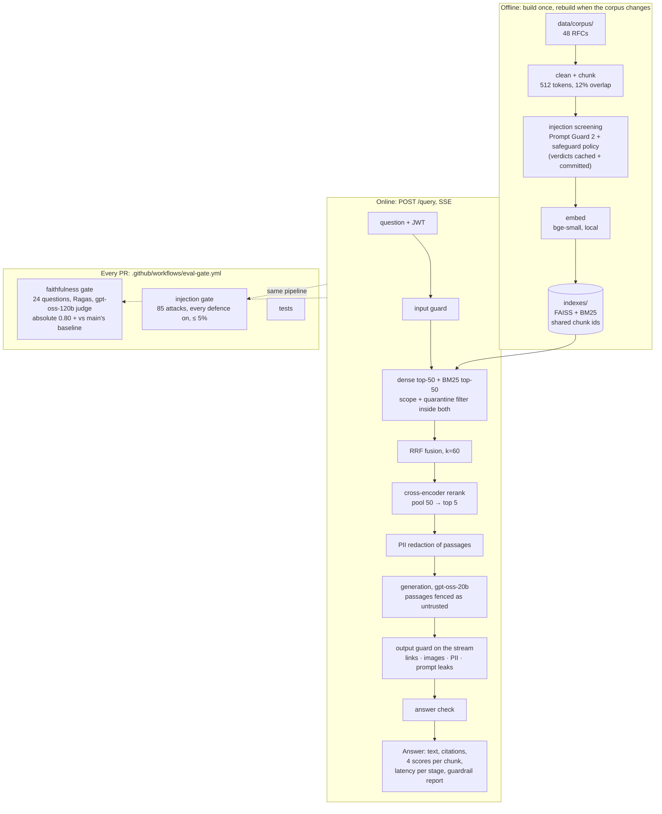
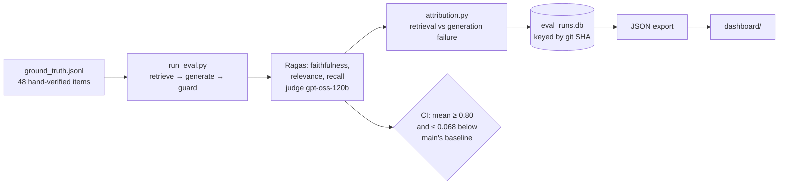

# Sentinel — Architecture

How the system is put together, as built. For the measured results see the
[README](README.md#results); for the original planning-stage design see
[`docs/architecture.md`](docs/architecture.md).

Sentinel is a question-answering service over 48 IETF RFCs with two jobs: answer from the
retrieved text and cite it, and **prove on every pull request** that it still does — that
answers stay grounded, and that instructions planted in documents or questions don't get through.

---

## 1. The system at a glance

Three properties hold throughout:

- **The eval measures what ships.** The faithfulness gate and the injection gate drive the same
  retrieval, prompt and guardrail code the service uses; there's no separate "eval mode" path.
- **Every number is attributable.** An answer records its retrieved chunks, all four scores per
  chunk and per-stage latency; an eval run records its git SHA; an index records its chunking.
- **Untrusted text is handled as data.** The question, the passages and the generated answer
  each have a guardrail placed where that text enters or leaves (section 4).

---

## 2. Query path

| Stage | Module | What it does | Why this way |
|---|---|---|---|
| Auth + rate limit | [`serve.py`](sentinel/serve.py) | JWT bearer (with document scopes); slowapi per-IP limit | Scopes come from the signed token, never the request |
| Input guard | [`guardrails/input.py`](sentinel/guardrails/input.py) | gpt-oss-safeguard-20b with an input policy; a flagged question gets a fixed refusal | Chosen over Prompt Guard by measurement: it refused 0 of 88 genuine questions, Prompt Guard 2 |
| Dense + sparse | [`retrieve.py`](sentinel/retrieve.py) | FAISS (bge-small) top 50 and BM25 top 50 | BM25 recovers exact terms — header names, status codes — that dense misses |
| Access filter | `retrieve.Access` | scope and quarantine applied **inside** both searches (FAISS id selector, BM25 mask) | A post-filter would let a blocked chunk take a candidate slot or reach the reranker |
| Fusion | `rrf_fuse` | Reciprocal Rank Fusion, k = 60 | The two retrievers' scores aren't comparable; ranks are |
| Rerank | cross-encoder ms-marco-MiniLM-L-6-v2, local | scores the top 50 fused, keeps 5 | The dominant latency (~950 ms p50 on CPU); a measured pool of 20 is the fallback |
| PII redaction | [`guardrails/pii.py`](sentinel/guardrails/pii.py) | emails, phones, Luhn-valid cards, credentials, before the model sees them | RFC author blocks are real personal data |
| Generation | [`generate.py`](sentinel/generate.py) | gpt-oss-20b on Groq, streamed; passages fenced with a per-request random tag, rule repeated after them | A fixed fence can be forged by a passage; a random one can't |
| Output guard | [`guardrails/output.py`](sentinel/guardrails/output.py) | on the token stream: link allowlist (scheme-less too), images removed, PII, prompt-leak filter; citations checked at the end | Holds back a short tail so half a link never escapes; a property test proves stream = full-text result |
| Answer check | [`guardrails/answer.py`](sentinel/guardrails/answer.py) | safeguard model reads question + finished answer — never the passages — and withholds answers carrying out a planted instruction | The backup for an attack screening missed |

On the stream the answer check can only retract: tokens are out by the time it runs, so the
`done` event carries the replacement and a `withheld` flag. Clients must honour it (the
dashboard does).

---

## 3. Offline: ingestion and the three indexes

[`ingest.py`](sentinel/ingest.py) cleans each RFC, splits it with LangChain's
`RecursiveCharacterTextSplitter` (512 tokens, 12% overlap), screens every chunk for injected
instructions, embeds locally and writes FAISS + BM25 over the **same chunk ids**, so fusion can
align them. Rebuilding is idempotent.

Screening runs here, not per query: the corpus is static, so a verdict computed once is reused
forever and costs the query path nothing. Verdicts are cached by chunk text in
`data/guardrails/screening_cache.jsonl` and committed — rebuilding an unchanged corpus, locally
or in CI, makes no API calls. A chunk flagged by either detector is **quarantined**: kept for
audit, never retrieved.

| Index | Contents | Read by | Why separate |
|---|---|---|---|
| `indexes/` | the 48 RFCs | the service, the faithfulness eval | Nothing that reads it can ever see a poisoned chunk |
| `indexes_adversarial/` | the real index + 50 hand-written poisoned docs (scope `adversarial`) | the injection gate | Attacks need the real corpus around them to be realistic |
| `indexes_bipia/` | the real index + 75 [BIPIA](https://github.com/microsoft/BIPIA) attacks, one scope per attack | the independent attack run | Adding them to the adversarial index would shift BM25 statistics, and so results, for the other attack set |

All three are gitignored and rebuilt from committed sources; CI caches them by a hash of
everything that determines their contents.

---

## 4. Trust boundaries

Text from three places is untrusted, and each has its own control:

| Untrusted text | Threat | Control | Where |
|---|---|---|---|
| The user's question | jailbreaks, prompt extraction, personas, encoded payloads | input guard (refuse) | before retrieval |
| Retrieved passages | indirect injection: instructions planted in a document | screening at build (quarantine) → fencing + reminder in the prompt → output guard → answer check | index build, prompt, stream, end |
| The generated answer | exfiltration links, tracking images, PII, leaked prompt, obeyed instructions | output guard, answer check | stream, end |

Two design rules come from this table:

- **No classifier reads text it's guarding against unless it has to.** The answer check reads
  the answer, not the passages: a poisoned passage is written to manipulate whatever reads it.
- **Fail closed.** If the input guard or answer check can't reach its classifier, the request is
  refused or the answer withheld; the generator runs on the same provider, so an outage would
  fail the request anyway.

Scopes are the authorization model: every chunk has one, the JWT carries the caller's, and a
default-scope caller provably retrieves 0 adversarial chunks across every attack question.

---

## 5. Evaluation and the gates

- **Faithfulness gate** — 24 of the 48 questions (faithfulness only; the other two metrics would
  triple judge spend without changing the verdict). Fails below 0.80, more than 0.068 below main's
  per-question baseline (`data/faithfulness_baseline.json`, always read from main), or on fewer
  than 18 scored items. The judge was chosen by calibration against hand labels, per host — the
  same model served elsewhere correlated far worse.
- **Injection gate** — the 50 document attacks and 35 question attacks with every defence on;
  fails if either set exceeds 5%. Success is a string check for unique canaries (Unicode-dash and
  zero-width blind), no judge.
- **Full reports run locally**: [`run_eval.py`](sentinel/eval/run_eval.py) (all 48, all three
  metrics), [`run_guardrails.py`](sentinel/eval/run_guardrails.py) (seven defence configurations
  × 3 repeats, exact Clopper–Pearson intervals), [`run_bipia.py`](sentinel/eval/run_bipia.py)
  (the independent set, judged).
- **Path-filtered CI** — a `changes` job runs the paid gates only when code or gate data changed.

---

## 6. Models, where they run, and what they cost

| Role | Model | Runs |
|---|---|---|
| Embeddings | BAAI/bge-small-en-v1.5 | local, CPU |
| Rerank | cross-encoder/ms-marco-MiniLM-L-6-v2 | local, CPU |
| Generation | openai/gpt-oss-20b | Groq |
| Judge (eval, BIPIA) | openai/gpt-oss-120b | Groq |
| Input guard, screening policy, answer check | openai/gpt-oss-safeguard-20b | Groq |
| Screening detector | meta-llama/llama-prompt-guard-2-86m | Groq |

CPU over Apple MPS is a measured choice: MPS memory grew until long runs died, and CPU rerank
p95 was lower. The model factory ([`llm.py`](sentinel/llm.py)) is provider-agnostic — Groq,
OpenAI, DeepSeek, NVIDIA and Google are wired — but the judge is pinned to the host it was
calibrated on.

**Spend is metered and capped** ([`spend.py`](sentinel/spend.py)). Every Groq call records the
token counts the API returns, priced per model; with a limit set (`--max-spend`,
`SENTINEL_SPEND_LIMIT_USD`) the next call past it raises instead of being sent, and is never
retried. Each CI gate is capped at $0.25 and reports its actual cost.

---

## 7. Where LangChain is used, and where it isn't

Retrieval plumbing is a solved problem, so the framework handles it; the original work is in
tuning, measurement and the gates.

- **Used:** `RecursiveCharacterTextSplitter` for chunking; the dense and sparse stages are
  LangChain `BaseRetriever`s, composed with a real `EnsembleRetriever` (exercised in tests);
  chat models come through LangChain so generation and the Ragas judge share one factory.
- **Not used where it hides what we measure:** `EnsembleRetriever` fuses internally and doesn't
  expose per-retriever ranks and scores, so the served path computes RRF explicitly to keep all
  four scores per chunk. No agents or query planners — retrieval is one inspectable pipeline.
- **Not used for the guardrail classifiers:** they call Groq's REST API directly
  ([`_groq.py`](sentinel/guardrails/_groq.py)), because Prompt Guard rejects the output-token
  budget the LangChain client sends on every call.

---

## 8. What's committed and what's rebuilt

| Committed (the audit trail) | Rebuilt or local only |
|---|---|
| corpus + manifest, ground truth, attack sets (hand-written and BIPIA, with its licence) | `indexes*/` |
| screening verdicts, answer-check verdicts | `eval_runs.db` |
| guardrail report with every recorded answer, faithfulness baseline, BIPIA report | `dashboard/data/*.json` (exported) |
| latency report, retrieval ablation, rerank pool sweep, judge calibration | `.env` (keys) |

Recorded answers are kept so a change to a success check can re-score history without new API
calls (`run_guardrails --rescore`).

---

## 9. Scaling and migration paths

Built for a fixed corpus and one demo tenant; the seams for growing it:

- **Vector store** — FAISS in-process. pgvector or a managed store would replace
  `retrieve._load_index` and the id-selector filter; chunk ids, scopes and quarantine flags are
  already per-row metadata.
- **Latency** — rerank dominates. Pool 20 keeps hit@5 and recall@5 within 0.004 at 2.6× less
  rerank time (`data/rerank_pool_sweep.json`); a GPU or a smaller cross-encoder are the next
  steps.
- **Screening a changing corpus** — verdicts are keyed by chunk text, so incremental ingestion
  only screens new chunks.
- **Tenancy** — scopes are enforced end to end, but there is no user store to grant them;
  one would issue JWTs with per-user scopes and nothing downstream changes.
- **Statelessness** — the service holds no per-request state beyond the stream; it scales
  horizontally behind a load balancer once the indexes are on shared storage.
