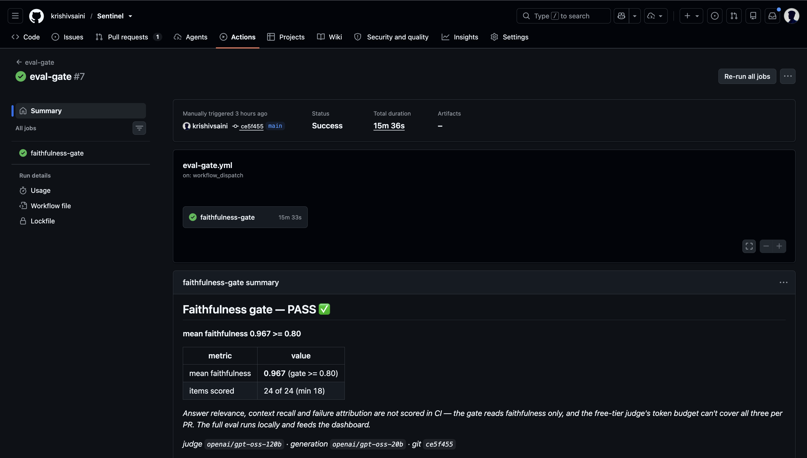
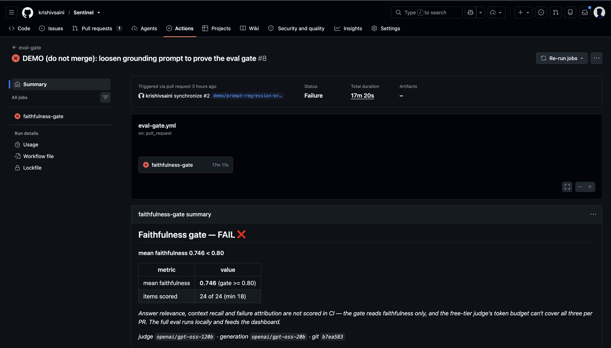
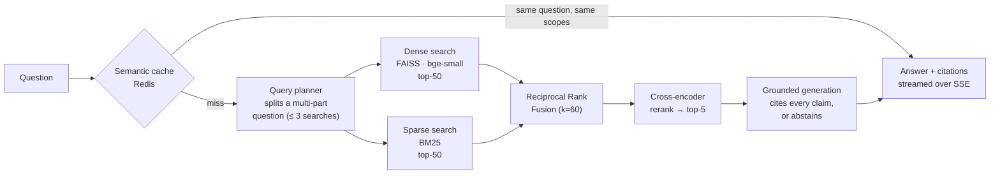

<div align="center">

# Sentinel

**Most RAG demos show that they answer. Sentinel proves — on every pull request — that its answers stay true to the sources, and that planted instructions don't get through.**


<br>


**[Live demo](https://sentinel-alpha-dusky.vercel.app/#query)** · [API docs](https://sentinel-api-oh6bzi2ava-uc.a.run.app/docs) · [Results](docs/results.md) · [Guardrails](docs/guardrails.md) · [Design](docs/design.md) · [Run it locally](docs/development.md) · [Architecture](ARCHITECTURE.md) · [CI gates](.github/workflows/eval-gate.yml)

</div>

---

## In 30 seconds

Sentinel answers questions about 48 IETF RFCs (HTTP, TLS, DNS, OAuth, QUIC and more). Every answer streams back with citations to the passages it came from, or says it doesn't know. Answering is the easy part. Sentinel is built around the two questions that decide whether an LLM feature can ship:

1. **Did this change make the answers worse?** CI scores the answers on every pull request against main's own baseline and blocks the merge if they become less faithful to the sources.
2. **Can a document steer the model?** Text planted in a document ("ignore your instructions…") is screened out before it's indexed, with three more layers behind that. 50 hand-written attacks and 75 from Microsoft's BIPIA benchmark measure how often anything gets through.

It runs on **Google Cloud Run**, provisioned with Terraform and deployed from GitHub Actions, for about **$0.0004 of model cost per answer**. A repeated or reworded question comes back from the semantic cache, kept in Redis, in **about 1 s instead of 16–20 s**, at a tenth of the cost, even after the service has scaled to zero. About 11,000 lines of Python and 330+ tests, and every number below comes from a script in this repo.

**Try it:** ask a question in the [live playground](https://sentinel-alpha-dusky.vercel.app/#query). The server sleeps when nobody's using it, so the first answer takes about a minute; after that ~15–20 s, and a repeated question ~1 s. The same dashboard shows the eval history, failure analysis and guardrail results. Or call the API directly from its [docs page](https://sentinel-api-oh6bzi2ava-uc.a.run.app/docs) as `demo` / `change-me`. The demo is rate-limited and has a small daily budget.

---

## What it proves

| | Result |
|---|---|
| **Blocks bad merges, even subtle ones** | a prompt that let the model answer from memory dropped faithfulness **0.967 → 0.746** and was blocked; two subtle regressions (0.855, 0.865) that pass a fixed 0.80 line fail the baseline gate, while every healthy run (0.904–0.993) passes |
| **Answers stay grounded** | faithfulness **0.951** on 48 hand-verified questions, scored by a judge that agrees with blind hand labels (r = 0.78) |
| **Hybrid retrieval earns its complexity** | hit@5 **0.729 → 0.896** (+23%) over dense or BM25 alone |
| **Poisoned documents** | **29% → 0%** of 50 attacks get through, in all 3 runs |
| **Attacks nobody here wrote** | **2 / 75** from Microsoft's BIPIA benchmark get through — both "answer in French" |
| **Jailbreaks in the question** | **19% → 4%**, with **0 / 88** genuine questions refused |
| **Multi-part questions** | a query planner raises the question parts covered from **15 to 22 of 32** and cuts abstentions from 6 to 1 |
| **Fast and cheap in production** | live on Cloud Run, a repeated or reworded question takes **~19 s → ~1 s** at **~10× less** model cost, from a semantic cache in Redis that survives scale-to-zero, with 0 false hits on 1,128 question pairs |
| **Built to run on a budget** | every LLM call metered; each CI gate capped at $0.25; ~$0.0004 per live answer |

Every number comes from a script in this repo and can be re-run — with sample sizes, 95% intervals and the failures shown alongside. The details: [results](docs/results.md) · [guardrails](docs/guardrails.md).

---

## Stack

| Layer | What it uses |
|---|---|
| **Retrieval** | **FAISS** (bge-small-en-v1.5) + **BM25**, fused with reciprocal rank fusion and re-scored by a **cross-encoder** (ms-marco-MiniLM); LangChain retrievers. Dense search can run in **PostgreSQL + pgvector** (HNSW) instead, behind one setting |
| **Generation** | gpt-oss-20b on **Groq**, streamed over **SSE** with citations; an LLM query planner splits multi-part questions into separate searches |
| **Caching** | a semantic answer cache (exact technical terms + embedding similarity ≥ 0.98) in **Redis** (Upstash) in production, or in memory |
| **Guardrails** | **Llama Prompt Guard 2** + policy models screen documents at index time; input and output guards, PII redaction, and an answer check that holds back unsupported answers |
| **API** | **FastAPI**; JWT auth with named accounts and revocable tokens; per-account rate limits; structured logs with per-stage latency and cost |
| **Evaluation** | **Ragas** faithfulness with a calibrated gpt-oss-120b judge; hit@k and recall@k; injection and BIPIA attack benchmarks |
| **Infra** | **Docker** on **Google Cloud Run**, provisioned with **Terraform**, secrets in Secret Manager; **GitHub Actions** runs the eval gates and the tests, with Postgres + pgvector and Redis service containers |
| **Dashboard** | **Next.js** + TypeScript: a playground and an operations view |

Production serves FAISS, with the cache in Redis; pgvector is tested locally and in CI and switches on with an environment variable ([why FAISS stays](docs/design.md#engineering-decisions)).

---

## What sets it apart

Most RAG projects stop at "it answers questions". Sentinel treats answer quality and safety as **tested properties of the codebase**:

- **Quality is a CI gate, not a dashboard.** A change that makes answers less grounded fails the build like a broken test — against main's own baseline, not just a fixed line.
- **Every failure is diagnosed.** The right passage was never retrieved, or it was and the model still got it wrong — two problems with opposite fixes.
- **The grader is graded.** The judge is checked against blind hand labels, and pinned to the host it was calibrated on.
- **Defences are measured, not listed.** Each guardrail is switched off in turn to show what it contributes, tested against an independent benchmark, and gated in CI.
- **Honest by construction.** Small samples carry exact confidence intervals; a measurement bug found later was corrected in public; what still gets through is named.

---

## The proof: a bad merge, blocked

[PR #2](https://github.com/krishivsaini/Sentinel/pull/2) loosens one thing: the prompt now lets the model answer from its own knowledge.

| Branch | Mean faithfulness | Items scored | Gate (≥ 0.80) |
|---|---|---|---|
| `main` | **0.967** | 24 / 24 | ✅ [pass](https://github.com/krishivsaini/Sentinel/actions/runs/39724557013) |
| PR #2 — loosened grounding prompt | **0.746** | 24 / 24 | ❌ [fail, merge blocked](https://github.com/krishivsaini/Sentinel/actions/runs/39724569826) |

| `main` — gate passes | PR #2 — gate blocks the merge |
|---|---|
|  |  |

<sub>Screenshots from before the baseline comparison below was added; a run takes 15–17 minutes over 24 of the 48 questions.</sub>

**A fixed line misses subtle regressions**, so the gate also compares each PR with main's own per-question baseline ([4 runs](data/faithfulness_baseline.json): mean 0.951, SD 0.034). It fails anything more than max(0.05, 2 SD) = **0.068** below, i.e. under 0.883:

| Run | Faithfulness | vs main's baseline | Gate |
|---|---|---|---|
| main, every recorded run | 0.904 – 0.993 | −0.047 at worst | ✅ pass |
| two subtle prompt regressions | 0.865 · 0.855 | −0.086 · −0.096 | ❌ fail — both passed the 0.80 line |
| PR #2 | 0.746 – 0.799 | −0.15 or more | ❌ fail |

The baseline is always read from main, so a PR can't pass by editing it.

More: the [full 48-question evaluation](docs/results.md#full-evaluation--48-questions), [whether each retrieval stage earns its place](docs/results.md#does-each-retrieval-stage-earn-its-place), [multi-part questions](docs/results.md#multi-part-questions), [the semantic cache](docs/results.md#repeated-questions-a-semantic-cache), [whether the judge can be trusted](docs/results.md#is-the-judge-trustworthy) and [latency per stage](docs/results.md#latency-per-stage).

---

## How it works



Each stage is timed on its own, so latency is reported per stage, never blended.

Around that path sit seven guardrails, each where its threat enters: documents are screened for planted instructions when the index is built; the question is screened before retrieval; access scopes are enforced inside both searches; personal data is redacted; the passages are fenced off as untrusted in the prompt; and the answer is checked twice before it's released. What each does, and what each is measured to stop: [guardrails](docs/guardrails.md). The components, the design choices and why: [design](docs/design.md) and [ARCHITECTURE.md](ARCHITECTURE.md).

---

## Run it

Python 3.11+ with [`uv`](https://docs.astral.sh/uv/) and a [Groq API key](https://console.groq.com/keys).

```bash
git clone https://github.com/krishivsaini/Sentinel.git && cd Sentinel
uv sync && cp .env.example .env          # set GROQ_API_KEY and SENTINEL_JWT_SECRET
uv run python -m sentinel.ingest         # build the indexes: local, no API calls
uv run python -m sentinel.serve          # http://localhost:8000
```

```bash
TOKEN=$(curl -s -X POST localhost:8000/token -d 'username=demo&password=change-me' | jq -r .access_token)
curl -N -X POST localhost:8000/query -H "Authorization: Bearer $TOKEN" \
  -H 'Content-Type: application/json' -d '{"question": "What does the HTTP 429 status code indicate?"}'
```

Evaluations, the dashboard, the optional Postgres and Redis backends, configuration and the repository layout: [docs/development.md](docs/development.md). Deploying to Cloud Run with Terraform: [deploy/README.md](deploy/README.md).

---

## Limitations

The main ones, stated plainly ([all of them](docs/design.md#limitations)):

| | |
|---|---|
| **Scale** | One corpus (48 RFCs) and 48 hand-built questions, so the intervals are wide and the numbers aren't claimed to transfer. Little real traffic so far. |
| **Latency** | A fresh answer takes ~15–20 s on Cloud Run's 2 vCPUs, almost all of it CPU reranking (~1 s on an M3). A cache hit takes ~1 s. |
| **Who wrote the tests** | The hand-written attacks share an author with the defences, and the multi-part questions and cache pairs were drafted by Claude without a person's review. |
| **Screening** | Can still be written around: 6 of 10 adaptive attacks pass it, and "answer in French" gets past every layer. |
| **The judge** | A model, calibrated against one labeller (blind r = +0.78). The CI gate scores 24 of the 48 questions. |

---

## Roadmap

- [ ] A screening policy that doesn't depend on the attacker addressing an AI — BIPIA's task hijacks and "answer in French" are its test
- [ ] A person's labels for the BIPIA judge, alongside the model-made ones
- [x] Entity recognition for names and postal addresses in the PII guard (private documents)
- [ ] A larger ground-truth set (80–120 questions)
- [x] Deployment: the API behind its guardrails, on Cloud Run with Terraform
- [x] Deployment: the dashboard, on Vercel
- [ ] Faster reranking on Cloud Run's CPUs (an ONNX build of the cross-encoder), the main latency cost
- [x] The Redis cache backend in production, so cache hits survive scale-to-zero

---
## Documentation

| Doc | Purpose |
|---|---|
| [docs/results.md](docs/results.md) | Every measured result except the guardrails: the CI gate, the full evaluation, the retrieval ablation, multi-part questions, the semantic cache, the judge, latency |
| [docs/guardrails.md](docs/guardrails.md) | The seven guardrails, how they're layered, and how often attacks get through |
| [docs/design.md](docs/design.md) | How it works, the engineering decisions, and the full limitations |
| [docs/development.md](docs/development.md) | Running, evaluating and configuring it locally; the repository layout |
| [deploy/README.md](deploy/README.md) | Cloud Run, Terraform, secrets and costs |
| [ARCHITECTURE.md](ARCHITECTURE.md) | The system as built: query path, indexes, trust boundaries, gates, models and cost |
| [data/ground_truth_audit.md](data/ground_truth_audit.md) | Ground-truth review and judge calibration |
| [docs/requirement.md](docs/requirement.md) | Functional and non-functional requirements |
| [docs/product_design.md](docs/product_design.md) | Product thesis, personas, dashboard IA |
| [docs/architecture.md](docs/architecture.md) | The original planning-stage design (superseded where they differ) |
| [docs/implementation_plan.md](docs/implementation_plan.md) | Phased build plan and risk register |
| [SENTINEL_BUILD_PLAN.md](SENTINEL_BUILD_PLAN.md) | The original build brief |

<div align="center">

MIT — see [LICENSE](LICENSE)

</div>
