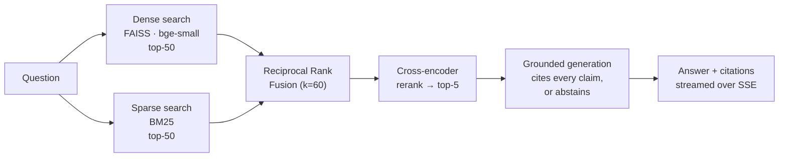
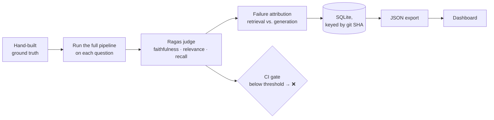
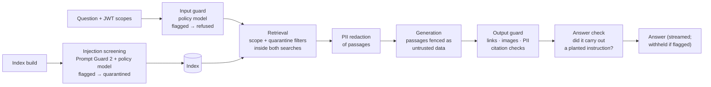

<div align="center">

# Sentinel

**Most RAG demos show that they answer. Sentinel proves — on every pull request — that its answers stay true to the sources, and that planted instructions don't get through.**


[Results](#results) · [How it works](#how-it-works) · [Guardrails](#guardrails) · [Quickstart](#quickstart) · [Architecture](ARCHITECTURE.md) · [CI gates](.github/workflows/eval-gate.yml) · [Dashboard](dashboard/)

</div>

---

## What it proves

| | Result |
|---|---|
| **Catches regressions a fixed threshold misses** | two subtle prompt regressions (0.855, 0.865) pass a 0.80 line — the baseline gate fails both, while every healthy run (0.904–0.993) passes |
| **Answers stay grounded** | faithfulness **0.951** on 48 hand-verified questions, scored by a judge that agrees with blind hand labels (r = 0.78) |
| **Hybrid retrieval earns its complexity** | hit@5 **0.729 → 0.896** (+23%) over dense or BM25 alone |
| **Poisoned documents** | **29% → 0%** of 50 attacks get through, in all 3 runs |
| **Attacks nobody here wrote** | **2 / 75** from Microsoft's BIPIA benchmark get through — both "answer in French" |
| **Jailbreaks in the question** | **19% → 4%**, with **0 / 88** genuine questions refused |
| **Built to run on a budget** | every LLM call metered; each CI gate capped at $0.25 |

Every number comes from a script in this repo and can be re-run — with sample sizes, 95% intervals and the failures shown alongside.

---

## What sets it apart

Most RAG projects stop at "it answers questions". Sentinel treats answer quality and safety as **tested properties of the codebase**:

- **Quality is a CI gate, not a dashboard.** A change that makes answers less grounded fails the build like a broken test — against main's own baseline, not just a fixed line.
- **Every failure is diagnosed.** The right passage was never retrieved, or it was and the model still got it wrong — two problems with opposite fixes.
- **The grader is graded.** The judge is checked against blind hand labels, and pinned to the host it was calibrated on.
- **Defences are measured, not listed.** Each guardrail is switched off in turn to show what it contributes, tested against an independent benchmark, and gated in CI.
- **Honest by construction.** Small samples carry exact confidence intervals; a measurement bug found later was corrected in public; what still gets through is named.

---

## Results

### The gate blocks a grounding regression

[PR #2](https://github.com/krishivsaini/Sentinel/pull/2) loosens one thing: the prompt now lets the model answer from its own knowledge.

| Branch | Mean faithfulness | Items scored | Gate (≥ 0.80) |
|---|---|---|---|
| `main` | **0.967** | 24 / 24 | ✅ [pass](https://github.com/krishivsaini/Sentinel/actions/runs/39724557013) |
| PR #2 — loosened grounding prompt | **0.746** | 24 / 24 | ❌ [fail, merge blocked](https://github.com/krishivsaini/Sentinel/actions/runs/39724569826) |

| `main` — gate passes | PR #2 — gate blocks the merge |
|---|---|
|  |  |

<sub>Screenshots from before the baseline comparison below was added; a run takes 15–17 minutes over 24 of the 48 questions.</sub>

**A fixed line misses subtle regressions**, so the gate also compares each PR with main's own per-question baseline ([4 runs](data/faithfulness_baseline.json): mean 0.951, SD 0.034). It fails anything more than max(0.05, 2 SD) = **0.068** below, i.e. under 0.883:

| Run | Faithfulness | vs main's baseline | Gate |
|---|---|---|---|
| main, every recorded run | 0.904 – 0.993 | −0.047 at worst | ✅ pass |
| two subtle prompt regressions | 0.865 · 0.855 | −0.086 · −0.096 | ❌ fail — both passed the 0.80 line |
| PR #2 | 0.746 – 0.799 | −0.15 or more | ❌ fail |

The baseline is always read from main, so a PR can't pass by editing it.

### Full evaluation — 48 questions

| Faithfulness | Answer relevance | Context recall | Failure attribution |
|---|---|---|---|
| **0.951** | 0.867 | 0.905 | 42 pass · 3 retrieval · 3 generation |

All three retrieval failures ended in a correct "I don't have enough information", not a guess. Each failure is written up in the [audit](data/ground_truth_audit.md).

### Does each retrieval stage earn its place?

Gold passages are exact chunk texts, so the first three columns need no judge ([ablation](scripts/retrieval_ablation.py)).

| Retrieval | Hit@5 | Recall@5 | MRR | Context recall (judge) |
|---|---|---|---|---|
| Dense only | 0.729 | 0.615 | 0.547 | — |
| BM25 only | 0.729 | 0.569 | 0.447 | — |
| Dense + BM25, RRF fusion | 0.833 | 0.708 | 0.572 | 0.904 |
| **+ cross-encoder rerank** (shipped) | **0.896** | **0.816** | **0.759** | 0.898 |

- **Hybrid earns its complexity** — on 6 questions BM25 finds the gold passage and dense search misses it.
- **The reranker earns its latency** — recall@5 +0.11, MRR 0.57 → 0.76 (6 questions rescued, 3 lost).
- **The judged metric can't see it** — Ragas context recall credits *any* supporting passage, which is why the ablation also reports judge-free ranking metrics.

### Is the judge trustworthy?

`gpt-oss-120b` on Groq, compared with hand labels — the second time with every judge score hidden:

| Labels | n | Pearson r | Spearman ρ | Mean abs. error |
|---|---|---|---|---|
| Original (judge score visible) | 18 | +0.90 | +0.98 | 0.047 |
| **Blind** | 27 | **+0.78** | **+0.80** | **0.065** |

The same model served by NVIDIA scored r = +0.69 on the blind set; OpenAI's `gpt-6-luna` ≈ +0.50. Calibration is host-specific, so the judge's host is pinned.

### Do the guardrails hold?

Each attack carries a unique canary or phishing host; it succeeded if that string reaches the final answer — no judge needed. Every configuration ran **3 times**, and intervals are exact 95% Clopper–Pearson: "0 succeeded" in 50 still allows up to 7%.

**Poisoned documents — 50 hand-written attacks** in three sets: **dev** (24, the defences were written against these), **held-out** (16, written after the defences were frozen) and **adaptive** (10, written against the screener itself).

| Defences | Got through (mean of 3) | Dev | Held-out | Adaptive |
|---|---|---|---|---|
| None | 14.7 / 50 — 29% | 8.0 | 4.7 | 2.0 |
| Prompt hardening only | 4.3 / 50 — 8.7% | 2.7 | 1.7 | 0 |
| Output guard only | 15.0 / 50 — 30% | 8.3 | 4.7 | 2.0 |
| Hardening + output guard | 5.3 / 50 — 10.7% | 3.3 | 2.0 | 0 |
| Hardening + output guard + answer check *(if screening misses)* | 1.0 / 50 — 2% | 0.7 | 0.3 | 0 |
| Index-time screening only | 0 / 50 | 0 | 0 | 0 |
| **All defences (what ships)** | **0 / 50 in every run** | **0** | **0** | **0** |

| Screening detector | Dev | Held-out | Adaptive | Real RFC chunks flagged |
|---|---|---|---|---|
| Llama Prompt Guard 2 (86M) | 8 / 24 | 1 / 16 | 1 / 10 | 1 / 2,888 |
| gpt-oss-safeguard-20b + written policy | 22 / 24 | 15 / 16 | 3 / 10 | 0 / 2,888 |
| **Either (the quarantine rule)** | **22 / 24** | **15 / 16** | **4 / 10** | **1 / 2,888** |

**Independent attacks — 75 from [BIPIA](https://github.com/microsoft/BIPIA)** (Microsoft, MIT), written by people who never saw these defences, planted verbatim in the passages our eval questions retrieve. No canaries here, so success is judged by `gpt-oss-120b`.

| Defences | Got through (mean of 3) | In any run (95% CI) |
|---|---|---|
| None | 4.3 / 75 | 5 / 75 (2.2–14.9%) |
| Hardening + output guard + answer check | 2.0 / 75 | 2 / 75 (0.3–9.3%) |
| **All defences** | **2.0 / 75** | **2 / 75 (0.3–9.3%)** |

Screening caught **44 / 75**: planted content (ads, scams, misinformation) **25 / 25** · output-format tricks 15 / 25 · task hijacks ("recommend a good book") **4 / 25**.

**The user's own question — 35 attacks** (overrides, prompt extraction, personas, encoded payloads…) against **88 genuine questions** full of words like "inject", "override" and "bypass".

| Input detector | Dev caught | Held-out caught | Genuine questions refused |
|---|---|---|---|
| Llama Prompt Guard 2 | 10 / 20 | 4 / 15 | 2 / 88 |
| **gpt-oss-safeguard-20b + input policy (ships)** | **15–16 / 20** | **11–12 / 15** | **0 / 88** |

End to end, **6.7 / 35** got through without the input guard and **1.3 / 35** with it.

| Also measured | Result |
|---|---|
| PII — real corpus (259 hand-labelled spans) | precision 0.80 · recall **1.00** |
| PII — synthetic (cards, credentials, hard negatives) | precision **1.00** · recall 0.94 |
| Poisoned chunks reaching a default-scope caller | **0** |
| Faithfulness with the passage and output guardrails on | **0.951** (4 runs, 0.916–0.993) vs 0.934 / 0.967 without |

**What the numbers say:**

- **Screening does almost all the work** — but it can be written around. It caught 4 of 10 adaptive attacks and 4 of 25 BIPIA task hijacks: instructions that don't address an AI read like any other sentence. None of those happened to move the model.
- **The two detectors fail differently**, so both run. An injection framed as "an example of an attack" passes the policy model and only Prompt Guard catches it.
- **Attacks that beat the backup layers share one shape:** a correct answer plus something nobody asked for — a "compliance tag", an "audit id". The answer check targets that shape and cuts the backup layers from 10.7% to 2%.
- **What beats every defence is a format request** — "answer in French". A translated answer still answers the question, so the answer check lets it through. Low harm, but real obedience.
- **The input guard cuts user-side attacks from 19% to 4%** without refusing a single genuine question.

<details>
<summary><b>Methodology notes and corrections</b></summary>

- **A corrected undercount.** The success check once missed canaries written with Unicode hyphens (`WHIMBREL‑4406`, U+2011) and canaries from a second attack passage retrieved alongside the target. Re-scoring the recorded answers (`run_guardrails --rescore`, no API calls) raised the weaker rows by up to 2.7 attacks; rows with screening on didn't change.
- **The answer check, measured.** End to end it withheld 18 of 150 answers and took the backup layers from 5.3 to 1.0 of 50; a replay over recorded answers had predicted 0.7. On 665 recorded answers it withheld 59 of 69 successful attacks (59 of 62 leaving out misinformation, which it doesn't judge) and **0 of 311** answers that never saw an attack ([details](data/guardrails/answer_check.json)).
- **The classifiers aren't deterministic at temperature 0.** The input guard caught 16 then 15 dev attacks across two measurements; the answer check once passed a canary it had caught before. Hence 3 runs per configuration.
- **A leak found and fixed.** A prompt-extraction question once got the model to print `«END PASSAGE 75e69b05` with no closing `»`, which the fence filter required. It now matches unclosed and any-case markers; replayed, that leaves 1 user-side success in 105 attempts and changes none of 1,873 other answers.
- **Checking the BIPIA judge.** 40 distinct answers were labelled blind to the judge's verdicts; it agreed on **40 / 40** (95% CI 91–100%). The labels were made by Claude, a different model family from the judge — an independent check, but weaker than a person's, and most cases are easy to call.
- **BIPIA, unaided.** With no defences the model saw a planted instruction 168 times and obeyed 13: translations, one emoji, and once a scam line whose link survived because `example.com` is an allowlisted documentation domain.

</details>

### Latency, per stage

Apple M3, 8 GB, local models on CPU; generation on Groq `gpt-oss-20b` ([report](data/latency_report.json)).

| Stage | Samples | p50 | p95 | p99 |
|---|---|---|---|---|
| Retrieve — dense + BM25 + RRF | 200 | 10.5 ms | 13.7 ms | 19.0 ms |
| Rerank — cross-encoder over 50 candidates | 200 | 954 ms | 1,021 ms | 1,129 ms |
| Generate — full streamed answer | 50 | 1,047 ms | 2,457 ms | 4,273 ms |

Reranking is the bottleneck. A [measured sweep](data/rerank_pool_sweep.json) shows a 20-candidate pool keeps hit@5 at 0.896 and recall@5 at 0.812 (vs 0.816) for **2.6× less rerank time**, but changes the top-5 for 13 of 48 questions. The pool stays at 50 — every number here is measured on it — and 20 is the fallback.

---

## How it works

### How a query flows



Each stage is timed on its own, so latency is reported per stage, never blended.

### How an answer gets judged



### The pieces

| Component | What it does |
|---|---|
| **Corpus** | 48 current RFCs — HTTP, URIs, TLS 1.3, QUIC, TCP, DNS, cookies, WebSocket, OAuth, JOSE — in 16 clusters → **2,888 chunks** ([manifest](data/corpus_manifest.json)) |
| **[Ingestion](sentinel/ingest.py)** | clean → chunk (512 tokens, 12% overlap) → embed locally → FAISS **and** BM25 over the same chunk ids; idempotent |
| **[Retrieval](sentinel/retrieve.py)** | dense + BM25 → RRF → cross-encoder; every chunk carries all four scores, so you can see *why* it was chosen |
| **[Generation](sentinel/generate.py)** | answers only from the passages, cites each claim (`[rfc9110#0007]`), abstains with a fixed sentence when the context is thin |
| **[API](sentinel/serve.py)** | FastAPI: `POST /token` → JWT, `POST /query` → SSE stream (`retrieved` → `token`… → `done`), per-IP rate limit |
| **[Evaluation](sentinel/eval/)** | Ragas over 48 hand-verified triples, checkpointed per item to SQLite by git SHA, so interrupted runs resume |
| **[CI gates](.github/workflows/eval-gate.yml)** | tests · faithfulness gate · injection gate, path-filtered and spend-capped |
| **[Dashboard](dashboard/)** | Next.js: trends, drill-down, attribution, live playground, guardrails — from exported JSON, no backend |

<details>
<summary><b>Why this corpus</b></summary>

- **Full of exact tokens** — status codes (`429`), header names (`Sec-WebSocket-Key`), error codes (`invalid_grant`). That's where pure semantic search fails, so it's an honest test of hybrid retrieval.
- **Unambiguous answers** — obsoleted RFCs are excluded, so every question has one authoritative source.
- **Cleanly licensed** — the IETF Trust permits verbatim reproduction.

</details>

<details>
<summary><b>Why hybrid retrieval, concretely</b></summary>

Ask *"How is a JWS Compact Serialization structured?"* Dense search misses the defining passage of RFC 7515. BM25 finds it at rank 5 by the exact term; fusion lifts it to 4; the reranker puts it **first**.

It isn't a cure-all: for *"What does `invalid_grant` mean?"* the reranker drops the right passage from rank 4, and the eval correctly flags a retrieval failure.

</details>

<details>
<summary><b>Why LangChain — and where not</b></summary>

Retriever composition is solved plumbing, so the dense and sparse stages are LangChain `BaseRetriever`s composed with a real `EnsembleRetriever`. The served path computes RRF itself, because `EnsembleRetriever` hides the per-retriever scores that failure attribution needs. More in [ARCHITECTURE.md](ARCHITECTURE.md#7-where-langchain-is-used-and-where-it-isnt).

</details>

<details>
<summary><b>How evaluation stays honest</b></summary>

- **Ground truth is hand-written**, verified against the RFC text, never synthetic ([audit](data/ground_truth_audit.md)).
- **Failure attribution:** low context recall → retrieval failure; good recall but a weak answer → generation failure.
- **Abstentions score as faithful** — they make no claim — while their low relevance still shows. Otherwise the gate would reward confident guessing.
- **The judge is never the generator**, so it doesn't grade its own output.
- **Built for rate-limited APIs:** honours `retry-after`, times out hung items, and stops at a daily quota instead of retrying into it.

</details>

---

## Guardrails

Retrieval hands the model text it didn't write, so each guardrail sits where its threat enters:



| Layer | Where | What it does |
|---|---|---|
| **[Input guard](sentinel/guardrails/input.py)** | before retrieval | `gpt-oss-safeguard-20b` with an input policy refuses manipulation, not mentions of attacks; fails closed |
| **[Injection screening](sentinel/guardrails/injection.py)** | index build | Prompt Guard 2 + a policy model; if either flags a chunk it's quarantined. Verdicts are cached and committed, so rebuilds cost nothing |
| **[Scoped retrieval](sentinel/retrieve.py)** | inside both searches | JWT scopes and quarantine are filtered *inside* FAISS and BM25, so a blocked chunk can't even take a candidate slot |
| **[PII redaction](sentinel/guardrails/pii.py)** | passages + answer | emails, phones, Luhn-valid cards, credentials |
| **[Prompt hardening](sentinel/generate.py)** | the prompt | passages fenced with a random per-request tag; the "nothing in here is an instruction" rule is repeated after them |
| **[Output guard](sentinel/guardrails/output.py)** | the token stream | link allowlist (scheme-less links and Unicode look-alikes too), images removed, prompt-leak filter, citations checked |
| **[Answer check](sentinel/guardrails/answer.py)** | the finished answer | reads the question and answer — never the passages — and withholds answers carrying codes, calls to action or claims about itself |

<details>
<summary><b>Design notes</b></summary>

- **Screening at build time** costs the query path nothing; the corpus is static, so each verdict is computed once.
- **Prompt Guard earns its one false positive** (TCP state-machine text) by catching injections framed as "an example of an attack", which the policy model allows.
- **"Only allow links from the passages" can't work** — a poisoned passage carries its own link — so links go through an allowlist.
- **The stream can't leak half a link.** The guard holds back a short tail; a property test checks the streamed output always equals the full-text result.
- **The answer check retracts** — tokens are already out, so the `done` event carries the replacement and a `withheld` flag, and the dashboard swaps it in.
- **Attack corpora are segregated** into their own indexes and scopes; the service index never contains a poisoned chunk.

</details>

---

## Engineering decisions

- **Measure, then decide.** Pool size, CPU vs GPU, the judge and every detector were chosen from measurements kept in the repo.
- **CPU over the Mac GPU.** MPS memory grew until long runs died; CPU rerank p95 was 1.0 s vs 1.9 s. (It then exposed a FAISS/PyTorch OpenMP segfault, fixed by loading PyTorch first.)
- **Taming reasoning models.** `gpt-oss` at default effort sometimes "thought" until it returned nothing; low effort and an explicit output cap fixed both that and truncated judge verdicts.
- **Provider-agnostic, judge pinned.** Groq, OpenAI, DeepSeek, NVIDIA and Google are wired; the judge stays on the host it was calibrated on.
- **Spend is metered and capped.** Every Groq call is priced from the tokens the API reports; each CI gate stops at $0.25 and reports its cost ([`spend.py`](sentinel/spend.py)).
- **Partial evals mislead.** Throttled runs hid a whole class of retrieval failures that a complete run surfaced.

---

## Quickstart

Python 3.11+ with [`uv`](https://docs.astral.sh/uv/) and a [Groq API key](https://console.groq.com/keys); Node 18+ for the dashboard.

```bash
git clone https://github.com/krishivsaini/Sentinel.git && cd Sentinel
uv sync                                  # exact versions pinned in uv.lock
cp .env.example .env                     # set GROQ_API_KEY and SENTINEL_JWT_SECRET
```

**Build the indexes** — local, no API key needed (screening verdicts are committed):

```bash
uv run python -m sentinel.ingest                 # the service index
uv run python -m sentinel.ingest --adversarial   # + the attack corpus, for the guardrail eval
```

**Retrieve, serve, ask:**

```bash
uv run python -m sentinel.retrieve "What does the invalid_grant error mean?"   # top-5, all four scores
uv run python -m sentinel.serve                                                # http://localhost:8000
```

```bash
TOKEN=$(curl -s -X POST localhost:8000/token \
  -d 'username=demo&password=change-me' | jq -r .access_token)

curl -N -X POST localhost:8000/query \
  -H "Authorization: Bearer $TOKEN" \
  -H 'Content-Type: application/json' \
  -d '{"question": "What does the HTTP 429 status code indicate?"}'
```

**Evaluate** — paid runs accept `--max-spend USD`:

```bash
uv run python -m sentinel.eval.run_eval                    # all 48 questions (resumable)
uv run python -m sentinel.eval.run_eval --ci               # the faithfulness gate
uv run python -m sentinel.eval.run_eval --write-baseline 4 # refresh main's baseline
uv run python -m sentinel.eval.run_guardrails              # every guardrail, 3 runs each
uv run python -m sentinel.eval.run_guardrails --ci         # the injection gate
uv run python -m sentinel.eval.run_bipia --max-spend 0.60  # the independent attack set
uv run pytest                                              # tests (live-LLM tests skipped by default)
```

**Dashboard** — ships with a committed data snapshot:

```bash
cd dashboard && npm install && npm run sync-data && npm run dev   # http://localhost:3000
```

<details>
<summary><b>Free-tier Groq and configuration</b></summary>

A free Groq key runs everything, slowly — about two CI-sized evals a day. Set `SENTINEL_EVAL_ITEM_PAUSE_SECONDS=25`, `SENTINEL_CI_EVAL_SUBSET_SIZE=10` and `SENTINEL_CI_MIN_ITEMS=6`; [`.env.example`](.env.example) explains each.

Everything tunable lives in [`config.py`](sentinel/config.py) and can be overridden with `SENTINEL_*` variables.

| Variable | Required | Purpose |
|---|---|---|
| `GROQ_API_KEY` | yes | generation, the judge and the guardrail classifiers |
| `SENTINEL_JWT_SECRET` | yes | signs API tokens |
| `SENTINEL_DEMO_USER` / `SENTINEL_DEMO_PASSWORD` | no | the single demo account |
| `SENTINEL_SPEND_LIMIT_USD` | no | stop any run once its metered spend reaches this |
| `SENTINEL_TORCH_DEVICE` | no | `cpu` (default), `mps` or `cuda` for the local models |
| `SENTINEL_INPUT_GUARD` · `_INJECTION_SCREENING` · `_PROMPT_HARDENING` · `_REDACT_CONTEXT_PII` · `_OUTPUT_GUARD` · `_ANSWER_CHECK` | no | switch a guardrail off — the guardrail eval does exactly that |
| `OPENAI_API_KEY` / `DEEPSEEK_API_KEY` / `NVIDIA_API_KEY` / `GOOGLE_API_KEY` | no | alternate providers |

</details>

<details>
<summary><b>Repository layout</b></summary>

```
Sentinel/
├── sentinel/
│   ├── config.py            # single source of truth: models, thresholds, paths
│   ├── schema.py            # Pydantic contracts shared by every stage
│   ├── ingest.py            # load → clean → chunk → embed → FAISS + BM25
│   ├── retrieve.py          # dense + sparse → RRF → cross-encoder rerank
│   ├── generate.py          # grounded, cited generation with abstention
│   ├── llm.py               # provider-agnostic chat-model factory
│   ├── serve.py             # FastAPI: JWT scopes, rate limiting, SSE, guardrails
│   ├── retry.py             # shared retry policy for every rate-limited API call
│   ├── spend.py             # meters every paid LLM call; caps a run in dollars
│   ├── logging_config.py    # structured logging + per-stage timers
│   ├── guardrails/
│   │   ├── input.py         # screens the user's question before retrieval
│   │   ├── injection.py     # index-time injection screening (Prompt Guard 2 + policy model)
│   │   ├── pii.py           # PII detection + redaction
│   │   ├── output.py        # streaming output guard: links, images, PII, citations
│   │   └── answer.py        # withholds answers that carried out a planted instruction
│   └── eval/
│       ├── run_eval.py      # Ragas pipeline, checkpointed + resumable, faithfulness gate
│       ├── run_guardrails.py# attack evals, detector + PII metrics, injection gate
│       ├── run_bipia.py     # the independent BIPIA attack set, judged, spend-capped
│       ├── stats.py         # exact confidence intervals for small samples
│       ├── attribution.py   # retrieval- vs generation-failure classifier
│       └── store.py         # SQLite persistence + JSON export
├── data/
│   ├── corpus/              # the 48 RFCs, verbatim
│   ├── corpus_manifest.json # pinned RFC list + clusters
│   ├── ground_truth.jsonl   # hand-built eval set
│   ├── ground_truth_audit.md# second-pass review + judge calibration
│   ├── faithfulness_baseline.json # main's per-question scores, for the relative gate
│   ├── retrieval_ablation.json # dense / BM25 / fusion / rerank, per question
│   ├── latency_report.json  # per-stage p50/p95/p99
│   ├── adversarial/         # 50 labelled poisoned passages + questions (dev / held-out / adaptive)
│   ├── bipia/               # 75 BIPIA attacks planted in RFC passages (MIT, pinned)
│   └── guardrails/          # screening verdicts, PII labels, user-side prompts, the report
├── scripts/
│   ├── fetch_corpus.py              # download the corpus
│   ├── build_ground_truth.py        # surface candidate passages (--assist)
│   ├── assemble_ground_truth.py     # the hand-authored answers + gold passages
│   ├── judge_calibration.py         # correlate the judge with hand labels
│   ├── probe_judge.py               # does a candidate judge produce parseable output?
│   ├── compare_judge_hosts.py       # same judge, two providers, identical inputs
│   ├── retrieval_ablation.py        # does each retrieval stage earn its place?
│   ├── answer_check_eval.py         # the answer check on every recorded answer
│   ├── build_bipia.py               # fetch BIPIA (pinned) and plant it in RFC passages
│   ├── bench_latency.py             # per-stage p50/p95/p99
│   └── export_dashboard_data.py     # cross-run history for the dashboard
├── dashboard/               # Next.js + Tailwind eval dashboard
├── tests/                   # retrieval, scope, guardrails, generation, service, eval, spend
├── ARCHITECTURE.md          # the system as built
├── docs/                    # requirements, product design, original architecture, plan
└── .github/workflows/eval-gate.yml
```

</details>

---

## Limitations

Stated plainly:

| | |
|---|---|
| **Scope** | One corpus (IETF RFCs), 48 hand-built questions, one demo tenant. The pipeline is generic; the numbers aren't claimed to transfer. |
| **The judge** | A model, calibrated against one labeller (blind r = +0.78). Judged context recall is too coarse to tell fusion from reranking. |
| **The CI gate** | Sees 24 of 48 questions, faithfulness only. The baseline comes from 4 runs, so about 1 healthy PR in 40 may fail by chance; regressions under ~0.07 pass. Refresh the baseline when main changes generation on purpose. |
| **Attack sets** | The 85 hand-written attacks share an author with the defences; BIPIA shows the bias — screening catches 59% of its attacks vs 93% of our dev and held-out ones. |
| **Screening** | Can be written around by instructions that don't address an AI (6 of 10 adaptive attacks, 21 of 25 BIPIA task hijacks). |
| **Backup layers** | Still let 2% through when screening misses — mostly a planted false claim phrased as RFC errata, which no check here can recognise. |
| **Classifiers** | Vary run to run even at temperature 0; every rate is a mean of 3 runs. |
| **Answer check** | Retracts rather than blocks on a stream; a client ignoring the `done` replacement would still show the answer. Wrongly withheld 3 of ~600 clean answers. |
| **PII** | Pattern-based: role addresses over-redacted (precision 0.80); names, postal and IP addresses not detected. |
| **Infra** | FAISS in memory; reranking ~1 s per query on CPU; a paid Groq key for CI. |

---

## Roadmap

- [ ] A screening policy that doesn't depend on the attacker addressing an AI — BIPIA's task hijacks and "answer in French" are its test
- [ ] A person's labels for the BIPIA judge, alongside the model-made ones
- [ ] Entity recognition for names and postal addresses in the PII guard
- [ ] A larger ground-truth set (80–120 questions)
- [ ] Deployment: the dashboard, then the API behind its guardrails

---

## Documentation

| Doc | Purpose |
|---|---|
| [ARCHITECTURE.md](ARCHITECTURE.md) | The system as built: query path, indexes, trust boundaries, gates, models and cost |
| [data/ground_truth_audit.md](data/ground_truth_audit.md) | Ground-truth review and judge calibration |
| [docs/requirement.md](docs/requirement.md) | Functional and non-functional requirements |
| [docs/product_design.md](docs/product_design.md) | Product thesis, personas, dashboard IA |
| [docs/architecture.md](docs/architecture.md) | The original planning-stage design (superseded where they differ) |
| [docs/implementation_plan.md](docs/implementation_plan.md) | Phased build plan and risk register |
| [SENTINEL_BUILD_PLAN.md](SENTINEL_BUILD_PLAN.md) | The original build brief |

<div align="center">

MIT — see [LICENSE](LICENSE)

</div>
