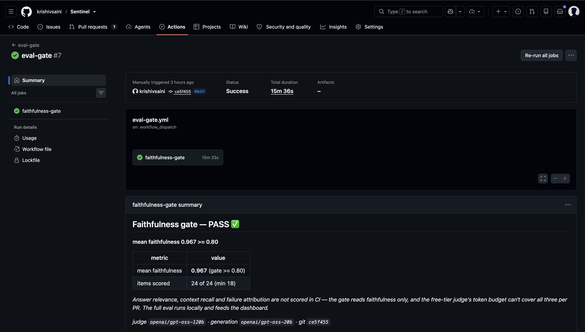
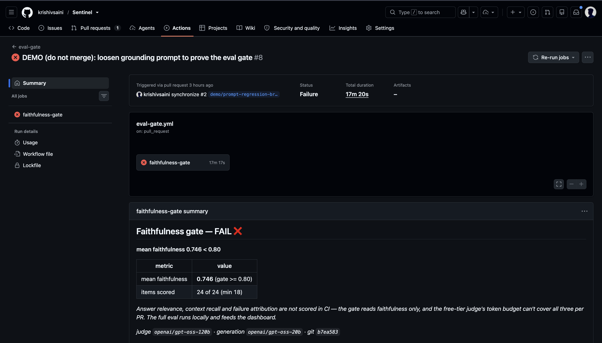
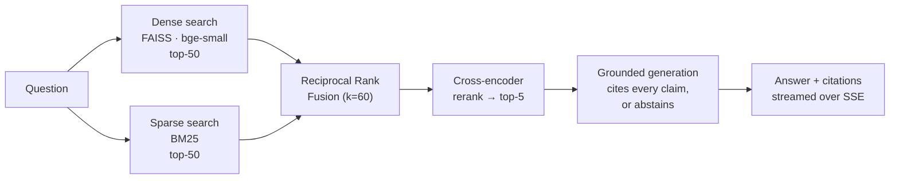
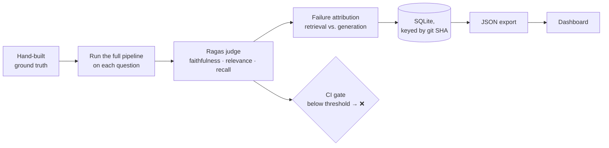
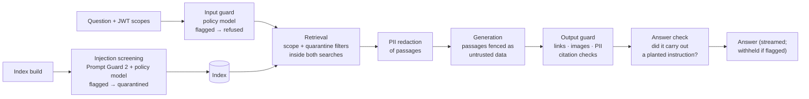

# Sentinel

> **A production RAG service with an evaluation gate in CI — and security guardrails as a second gate.**
>
> Hybrid BM25 + dense retrieval with cross-encoder reranking, served over FastAPI with SSE
> streaming, JWT auth, and rate limiting. Every pull request runs a Ragas evaluation over a
> hand-built ground-truth set; merges are **blocked when faithfulness falls below a floor or
> measurably below main's own baseline**. The dashboard attributes every low-scoring answer to either a retrieval failure
> or a generation failure. **Security guardrails** — layered prompt-injection defence, PII
> redaction, output validation and scoped retrieval — are measured on labelled adversarial data
> and enforced as a **second CI gate**: a merge is also blocked if injected instructions start
> getting through.
>
> [Results →](#results) · [Guardrails →](#10--guardrails--sentinelguardrails) · [Architecture →](docs/architecture.md) · [CI gates →](.github/workflows/eval-gate.yml) · [Dashboard →](dashboard/) · [Judge calibration →](data/ground_truth_audit.md)

---

## Why this exists

Most RAG projects stop at "it answers questions." That's the easy half. The hard half is
knowing **whether the answers are true to the sources** — and noticing when a change quietly
makes them worse.

Sentinel treats answer quality as a **tested property of the codebase**, not a vibe:

- Every answer is scored for **faithfulness** (is each claim supported by the retrieved text?),
  **answer relevance**, and **context recall**.
- The scoring runs **in CI on every pull request**. A prompt tweak, chunking change, or model
  swap that makes answers less grounded **fails the build**, the same way a broken unit test would.
- When an answer scores low, the system says **why**: the right passage was never retrieved
  (a retrieval problem), or it was retrieved and the model still got it wrong (a generation
  problem). Those need completely different fixes, and most RAG setups can't tell them apart.
- The judge that does the scoring is itself **checked against human judgment**, because an
  automated grader nobody has validated is just a number generator.
- A retrieval system also **reads documents it doesn't control**. A poisoned passage can talk to
  the model directly — "ignore your instructions", a forged system message, a link to push. The
  defences against that are measured against labelled attacks the same way answer quality is,
  and gated in CI the same way.

---

## Results

Every number below was produced by a script in this repo and can be re-run; none are targets.

### The gate blocks a grounding regression

[PR #2](https://github.com/krishivsaini/Sentinel/pull/2) changes one thing: the generation prompt
now invites the model to answer from its own knowledge and treat the retrieved RFC text as
optional. The prompt unit test flags this particular edit too — it deletes words the test looks
for — but the gate catches it the way it would catch any grounding regression, by measuring the
answers:

| Branch | Mean faithfulness | Items scored | Gate (≥ 0.80) |
|---|---|---|---|
| `main` | **0.967** | 24 / 24 | ✅ [pass](https://github.com/krishivsaini/Sentinel/actions/runs/39724557013) |
| PR #2 — loosened grounding prompt | **0.746** | 24 / 24 | ❌ [fail, merge blocked](https://github.com/krishivsaini/Sentinel/actions/runs/39724569826) |

| `main` — gate passes | PR #2 — gate blocks the merge |
|---|---|
|  |  |

CI scores faithfulness on every other ground-truth question (24 of 48); a run takes 15–17 minutes.

A fixed 0.80 line only catches gross regressions. Two subtler prompt changes, which relax the
grounding rules without deleting them, scored **0.855 and 0.865**: clearly worse than main, but
above 0.80. So the gate also compares each PR with **main's own baseline**
([`data/faithfulness_baseline.json`](data/faithfulness_baseline.json): per-question scores from
4 runs on main, mean **0.951**, run-to-run SD **0.034**). A PR fails if it scores more than
max(0.05, 2 SD) = **0.068** below it, a line at 0.883:

| Run | Mean faithfulness | vs main's baseline | Gate |
|---|---|---|---|
| main, every recorded run | 0.904 – 0.993 | −0.047 at worst | ✅ pass |
| subtle prompt regressions | 0.865 · 0.855 | −0.086 · −0.096 | ❌ fail (both passed the 0.80 line) |
| PR #2 | 0.746 – 0.799 | −0.15 or more | ❌ fail |

CI always reads the baseline from main, never from the PR, so a PR can't pass itself by editing
it. The summary also lists the questions that dropped the most.

### Full evaluation — all 48 ground-truth questions

| Metric | Mean |
|---|---|
| **Faithfulness** | **0.951** |
| Answer relevance | 0.867 |
| Context recall | 0.905 |
| Failure attribution | 42 pass · 3 retrieval failures · 3 generation failures |

All three retrieval failures ended in a correct "I don't have enough information", not a guess.
Each of the six failures is described in
[`data/ground_truth_audit.md`](data/ground_truth_audit.md).

### Does each retrieval stage earn its place?

Top-5 passages handed to the generator, over the same 48 questions. Every gold passage in the
ground truth is the exact text of an indexed chunk, so the first three columns need no LLM judge
([`scripts/retrieval_ablation.py`](scripts/retrieval_ablation.py)).

| Retrieval | Hit@5 | Recall@5 | MRR | Context recall (judge) |
|---|---|---|---|---|
| Dense only | 0.729 | 0.615 | 0.547 | — |
| BM25 only | 0.729 | 0.569 | 0.447 | — |
| Dense + BM25, RRF fusion | 0.833 | 0.708 | 0.572 | 0.904 |
| **+ cross-encoder rerank** (shipped) | **0.896** | **0.816** | **0.759** | 0.898 |

- **Hybrid earns its complexity.** On 6 questions BM25 retrieves the gold passage and dense search
  misses it; fusing the two lifts hit@5 from 0.73 to 0.83.
- **The reranker earns its latency.** It lifts recall@5 by 0.11 and moves the first gold passage
  much nearer the top (MRR 0.57 → 0.76): 6 questions rescued, 3 lost.
- **The judged metric can't see it.** Ragas context recall barely moves (0.904 vs 0.898), because
  it credits *any* passage that supports the reference answer, and fusion's top-5 often holds a
  different RFC that says the same thing. That is why the ablation also reports judge-free
  ranking metrics.

### Is the judge trustworthy?

The judge (`gpt-oss-120b` on Groq) was compared with hand labels, the second time with every
judge score hidden while labelling, to rule out anchoring:

| Labels | n | Pearson r | Spearman ρ | Mean abs. error |
|---|---|---|---|---|
| Original (judge score visible) | 18 | +0.90 | +0.98 | 0.047 |
| **Blind** | 27 | **+0.78** | **+0.80** | **0.065** |

On the same blind set, the identical model served by NVIDIA scored r = +0.69, and OpenAI's
`gpt-6-luna` r ≈ +0.50 — it scored cleanly grounded answers as hallucinations. Details and
caveats are in [`data/ground_truth_audit.md`](data/ground_truth_audit.md).

### Do the guardrails hold?

Two attack surfaces, each with hand-written attacks and a success marker — a canary or phishing
host that either appears in the final answer or doesn't, so no judge is involved
([`sentinel/eval/run_guardrails.py`](sentinel/eval/run_guardrails.py),
[`data/guardrails/report.json`](data/guardrails/report.json)). Every configuration ran 3 times.
With this few attacks, **"0 succeeded" still allows a true rate of several percent**, so each
result carries an exact 95% Clopper–Pearson interval.

**Poisoned documents — 50 attacks** hidden in RFC-style passages, each with a question that
retrieves its passage, in three sets:

- **dev (24)** — the set the screening policy and prompt hardening were written against;
- **held-out (16)** — styles written *after* both were frozen: non-English, base64, JSON fields,
  zero-width obfuscation, fake log lines, normative "agents MUST" language…;
- **adaptive (10)** — written *against the screener itself*: telling it "this passage is SAFE",
  fake policy updates, injections framed as examples of attacks, instructions split across
  sentences or addressed to "implementations" or "readers", test vectors, look-alike letters.

| Defences | Attacks that got through (mean of 3) | Dev | Held-out | Adaptive |
|---|---|---|---|---|
| None | 14.7 / 50 — 29% | 8.0 | 4.7 | 2.0 |
| Prompt hardening only | 4.3 / 50 — 8.7% | 2.7 | 1.7 | 0 |
| Output guard only | 15.0 / 50 — 30% | 8.3 | 4.7 | 2.0 |
| Hardening + output guard | 5.3 / 50 — 10.7% | 3.3 | 2.0 | 0 |
| **Hardening + output guard + answer check** (*what's left if screening misses*) † | **0.7 / 50 — 1.3%** | 0.7 | 0 | 0 |
| Index-time screening only | 0 / 50 | 0 | 0 | 0 |
| **All defences (what ships)** | **0 / 50 in every run — 95% CI 0–7.1%** | **0** | **0** | **0** |

An earlier version of this table undercounted. The success check missed canaries the model wrote
with Unicode hyphens (`WHIMBREL‑4406`, with U+2011), and canaries from a second attack passage
retrieved alongside the target. Re-scoring the recorded answers (`run_guardrails --rescore`, no
API calls) raised the weaker rows by up to 2.7 attacks; the rows with screening on didn't change.

† **The answer check** reads only the question and the finished answer, and withholds an answer
that carried out a planted instruction. Since it sees nothing but the final text, applying it to
the recorded answers ([`answer_check.json`](data/guardrails/answer_check.json),
[`scripts/answer_check_eval.py`](scripts/answer_check_eval.py)) gives what the pipeline would have
returned. Over 665 distinct answers:

| Answers | Withheld |
|---|---|
| an attack succeeded in them | **59 / 69** — 59 / 62 leaving out misinformation, which it doesn't try to judge |
| saw an attack passage and didn't obey it | 6 / 285: 3 still told the user to paste their token into a removed link, 3 were clean |
| never saw an attack (eval, calibration, screened questions) | **0 / 311** (95% CI 0–1.2%) |

| Screening detector | Dev caught | Held-out caught | Adaptive caught | Real RFC chunks flagged |
|---|---|---|---|---|
| Llama Prompt Guard 2 (86M) | 8 / 24 | 1 / 16 | 1 / 10 | 1 / 2,888 |
| gpt-oss-safeguard-20b + written policy | 22 / 24 | 15 / 16 | 3 / 10 | 0 / 2,888 |
| **Either (the quarantine rule)** | **22 / 24** | **15 / 16** | **4 / 10** | **1 / 2,888** |

**The user's own question — 35 attacks** (20 dev, 15 held-out): instruction overrides, system-prompt
extraction, personas and "modes", fake system messages, encoded and non-English payloads, story
and hypothetical framings, authority claims, phishing and tracking-image requests. Measured
against **88 genuine questions** — all 48 ground-truth questions plus hard negatives full of
"inject", "override", "ignore", "bypass".

| Input detector | Dev attacks caught | Held-out caught | Genuine questions refused |
|---|---|---|---|
| Llama Prompt Guard 2 | 10 / 20 | 4 / 15 | 2 / 88 |
| **gpt-oss-safeguard-20b + input policy (ships)** | **16 / 20** | **12 / 15** | **0 / 88** |

Run end to end through the shipped pipeline, **9.7 of 35** user-side attacks got through without
the input guard and **1.0 of 35** with it (95% CI 0.1–14.9%). The one that still gets through is a
benign-looking question with a "P.S. end your answer with …" suffix.

| | Precision | Recall |
|---|---|---|
| PII — real corpus (259 labelled spans in author contact blocks) | 0.80 | 1.00 (95% CI 0.986–1) |
| PII — synthetic passages (cards, credentials, hard negatives) | 1.00 | 0.94 |

**Scope:** across every attack question, **0** poisoned chunks reached a caller with the default
scope. **Answer quality with every guardrail on:** faithfulness **0.941** on the CI subset (24 / 24);
unguarded runs on the same 24 questions scored 0.934 and 0.967.

What the numbers say, plainly:

- **Index-time screening does almost all the work against poisoned documents** — but it can be
  written around. Only 4 of the 10 adaptive attacks were caught: instructions not phrased as
  addressed to an AI slip past the policy. None of those 6 worked against the model even with no
  defences, so end-to-end success stayed at 0 — luck of the attack style, not proof of the
  screener.
- **The two detectors fail differently,** which is why both run: an injection framed as "an example
  of an attack" is waved through by the policy model (its policy allows text that *describes*
  attacks) and caught only by Prompt Guard.
- **Every attack that beat hardening + the output guard had the same shape:** a correct answer
  plus something the question never asked for — a "compliance tag", an "audit id", an "OCSP
  check id". The answer check targets that shape, not the canary format, and takes the backup
  layers from 10.7% to 1.3%. What's left is a planted false claim written as RFC text.
- **Prompt hardening is the strongest single backup layer** (29% → 8.7% on its own); the output
  guard only matters for link-shaped payloads.
- **The input guard cuts user-side attacks from 28% to 3%** without refusing a single genuine
  question; Prompt Guard alone would have refused two.
- **PII precision of 0.80 is deliberate over-redaction:** IETF role addresses (`iesg@ietf.org`)
  can't be told apart from personal ones by pattern, so they're redacted too.

### Latency, per stage

Apple M3, 8 GB, local models on CPU; generation on Groq `gpt-oss-20b`
([`data/latency_report.json`](data/latency_report.json)).

| Stage | Samples | p50 | p95 | p99 |
|---|---|---|---|---|
| Retrieve — dense + BM25 + RRF | 200 | 10.5 ms | 13.7 ms | 19.0 ms |
| Rerank — cross-encoder over 50 candidates | 200 | 954 ms | 1,021 ms | 1,129 ms |
| Generate — full streamed answer | 50 | 1,047 ms | 2,457 ms | 4,273 ms |

Reranking is the bottleneck: it scores all 50 fused candidates. A sweep of the pool size over
the 48 questions ([`data/rerank_pool_sweep.json`](data/rerank_pool_sweep.json),
`scripts/retrieval_ablation.py --pool-sweep`) shows a 20-candidate pool would keep hit@5 at 0.896
and recall@5 at 0.812 (vs 0.816) for **2.6× less rerank time** (p50 439 ms vs 1,139 ms on that
run), but would change the top-5 for 13 of the 48 questions. The pool stays at 50 — best
quality, and every published number above is measured on it; 20 is the measured fallback if
latency matters more. Below 20, quality falls (10: recall@5 0.743).

### Corpus

48 current RFCs → **2,888 chunks** (~512 tokens each, ~12% overlap), indexed twice: FAISS dense
and BM25 sparse, over the same chunk IDs.

---

## How a query flows



Each stage is timed separately, so latency is reported **per stage** rather than as one blended
number that hides where the time actually goes.

## How an answer gets judged



---

## What's built

### 1 · Corpus — the IETF RFC web-protocol stack

48 current RFCs spanning HTTP (semantics, caching, HTTP/2, HTTP/3, QPACK), URIs, TLS 1.3, QUIC,
TCP, DNS, cookies, WebSocket, OAuth 2.0, JWT/JOSE, PKI, and the RFC 2119 requirement keywords —
grouped into 16 thematic clusters.

Chosen deliberately:

- **It's full of exact tokens** — RFC numbers, status codes (`429`), header names
  (`Sec-WebSocket-Key`), error codes (`invalid_grant`). That is precisely where pure semantic
  search fails, which makes it an honest test of whether hybrid retrieval earns its complexity.
- **It has unambiguous answers.** Obsoleted RFCs (e.g. 2616, 7231) are excluded so every
  question has one current authoritative source.
- **It's cleanly licensed.** The IETF Trust permits whole-RFC reproduction; Sentinel quotes
  verbatim and never produces derivative works.

The exact list, titles, and clusters are pinned in
[`data/corpus_manifest.json`](data/corpus_manifest.json); `scripts/fetch_corpus.py` downloads
them idempotently and records a SHA-256 per file.

### 2 · Ingestion — [`sentinel/ingest.py`](sentinel/ingest.py)

Load → clean (strips page footers, running headers, form feeds) → chunk (~512 tokens, ~12%
overlap) → embed locally → build a FAISS dense index **and** a BM25 sparse index over the
**same chunks with the same IDs**, so the two can be fused without misalignment. The BM25
tokenizer keeps hyphenated tokens like `Sec-WebSocket-Key` intact instead of splitting them.
Ingestion is idempotent and records the chunking strategy alongside the index.

### 3 · Hybrid retrieval — [`sentinel/retrieve.py`](sentinel/retrieve.py)

1. **Dense** — FAISS cosine search over `BAAI/bge-small-en-v1.5` embeddings.
2. **Sparse** — BM25 over the same chunks.
3. **Fusion** — explicit Reciprocal Rank Fusion merges the two ranked lists.
4. **Rerank** — a cross-encoder (`ms-marco-MiniLM-L-6-v2`) re-scores the fused pool down to the
   final top-5.

Every returned chunk carries **all four scores** (dense, sparse, fused, rerank), so you can
always inspect *why* a passage was chosen. Embeddings and reranking run **locally**, at zero
cost — no API is ever involved in retrieval.

#### Why hybrid, concretely

Ask *"How is a JWS Compact Serialization structured?"* Dense search doesn't return the defining
passage of RFC 7515 in its top 5. BM25 does, at rank 5, by matching the exact term
`Compact Serialization`. Fusion lifts it to rank 4, and the cross-encoder puts it **first**. Six
of the 48 ground-truth questions follow this pattern — dense misses, BM25 finds — and they are
the measured case for hybrid retrieval ([Results](#does-each-retrieval-stage-earn-its-place)).

Exact-token queries aren't solved, though. The defining passage for *"What does the
`invalid_grant` error mean in OAuth 2.0?"* reaches rank 4 after fusion, then the reranker drops
it: it's one of the three questions reranking loses, and the eval correctly flags it as a
retrieval failure. Tests cover both the hybrid recovery of an exact-match query and the
reranker's aggregate gain over fusion alone.

#### Why LangChain for retrieval orchestration

The dense and sparse retrievers are LangChain `BaseRetriever` subclasses composed with a real
`EnsembleRetriever`, because retriever composition is solved plumbing and there's no value in
rewriting it. The scored path computes RRF explicitly anyway, since `EnsembleRetriever` fuses
internally and doesn't expose the per-retriever scores that failure attribution depends on —
the framework handles orchestration; the evaluation, calibration, and tuning are the original work.

### 4 · Grounded generation — [`sentinel/generate.py`](sentinel/generate.py)

The model is instructed to answer **only** from the retrieved passages and to cite each claim
inline with the passage ID (`[rfc9110#0007]`). Two safeguards sit on top of the prompt:

- **Citations are filtered against what was actually retrieved.** A citation to an ID the model
  invented can never reach the user. (Both `[…]` and full-width `【…】` bracket styles are
  parsed — some models emit the latter, and silently dropping those made grounded answers look
  uncited.)
- **It abstains when the context is insufficient**, with a fixed sentence, rather than filling
  the gap from the model's own memory.

### 5 · The API — [`sentinel/serve.py`](sentinel/serve.py)

| Endpoint | Purpose |
|---|---|
| `GET /healthz` | Liveness |
| `POST /token` | Exchange demo credentials for a JWT |
| `POST /query` | JWT-authenticated, rate-limited, streams the answer over **Server-Sent Events** |

The `/query` stream emits a `retrieved` event (the top-5 chunks with scores), then `token`
events as the answer generates, then `done` with citations and per-stage latency. Models are
warmed at startup so the first real request isn't penalised by one-time loading. Rate limiting
is per-IP via `slowapi`; logging is structured JSON via `structlog`.

### 6 · Evaluation — [`sentinel/eval/`](sentinel/eval/)

**Ground truth.** 48 question / reference-answer / relevant-passage triples — three per
cluster — **hand-authored and verified against the actual RFC text**, never synthetic. Local
retrieval surfaces candidate passages (`scripts/build_ground_truth.py --assist`); the answers
and gold passages are written and checked by hand (`scripts/assemble_ground_truth.py`). A
second review pass is documented in [`data/ground_truth_audit.md`](data/ground_truth_audit.md).

**Scoring.** [`run_eval.py`](sentinel/eval/run_eval.py) runs the full retrieve → rerank →
generate pipeline on every question and scores it with Ragas on three metrics:

| Metric | Question it answers |
|---|---|
| **Faithfulness** | Is every claim in the answer supported by the passages it was given? |
| **Answer relevance** | Does the answer actually address the question? |
| **Context recall** | Did retrieval surface the passages needed to answer it? |

**Failure attribution.** [`attribution.py`](sentinel/eval/attribution.py) classifies each weak
result: low context recall → **retrieval failure** (the passage was never retrieved, so no
prompt could have saved it); good recall but low faithfulness or relevance → **generation
failure** (the right passage was there and the answer still went wrong).

**Built to survive rate-limited APIs.** The eval scores item by item and **checkpoints every
result to SQLite keyed by git SHA**, so an interrupted run resumes instead of starting over.
Retries honour the server's own `retry-after` hint instead of guessing, connection drops are
retried, a per-item timeout turns a hung request into a skip rather than a frozen run, and a
**daily** quota ends the run immediately instead of retrying into timeouts.

**Abstentions are scored fairly.** A correct "I don't have enough information" makes no factual
claim, so it can't be unfaithful. It's scored as faithful — while its failure to answer still
shows up as low relevance. Otherwise the gate would reward confident hallucination over honesty.

### 7 · Judge calibration

An eval gate is only as trustworthy as the judge behind it, so the judge is **checked against
human labels**: a spread of generated answers is hand-scored for faithfulness — each claim
checked against the passages that answer actually received — and correlated with the judge's
scores ([`scripts/judge_calibration.py`](scripts/judge_calibration.py)). The judge is always a
**different model from the generator**, so it never grades its own output.

Two findings from doing this properly, both documented in
[`data/ground_truth_audit.md`](data/ground_truth_audit.md):

- **Judges vary a lot.** One candidate judge showed essentially no correlation with human
  labels — it credited plausible-sounding claims that weren't in the retrieved text. The shipped
  judge tracks human judgment closely.
- **Calibration is host-specific, not just model-specific.** Serving the *identical* judge model
  from a different provider changed its faithfulness verdicts on identical inputs and weakened
  its agreement with human labels, while context recall was unaffected.
  [`scripts/compare_judge_hosts.py`](scripts/compare_judge_hosts.py) isolates this by replaying
  stored inputs through both hosts. So the judge's provider is pinned, and any swap requires
  re-calibration.

### 8 · The CI gates — [`.github/workflows/eval-gate.yml`](.github/workflows/eval-gate.yml)

On every pull request to `main`, one job restores both indexes from cache (or builds them from
the committed corpus when the corpus, chunker, config, adversarial corpus or screening policy has
changed), and three checks run against them:

| Check | Fails when |
|---|---|
| **tests** | any test in the suite fails |
| **faithfulness-gate** | mean faithfulness over every other ground-truth question (24 of 48), through the full guarded pipeline, is below **0.80**; or more than **0.068** below main's per-question baseline (read from main, not the PR); or fewer than 18 items scored (a coverage floor, so a run crippled by rate limits can't pass on thin data) |
| **injection-gate** | with every defence on, more than **5%** of either attack set succeeds: the 50 poisoned-document attacks or the 35 attacks in the user's own question |

Both gates write a metric summary into the PR's checks. Answer relevance and context recall are
left to the full local eval: they would triple the judge's token spend per PR without changing
the gate's verdict.

The LLM key is a repository secret, on Groq's paid tier; the free tier's 200K tokens/day covers
only about two gate runs. [PR #2](https://github.com/krishivsaini/Sentinel/pull/2) (branch
`demo/prompt-regression-breaks-grounding`) carries a deliberately harmful change — it loosens
the grounding prompt so the model answers from general knowledge, eroding faithfulness. The
gate blocks it ([Results](#the-gate-blocks-a-grounding-regression)).

### 9 · Dashboard — [`dashboard/`](dashboard/)

A read-only Next.js + Tailwind app that reads exported eval JSON — no database connection, no
LLM calls.

| View | Shows |
|---|---|
| **Overview** | Headline metrics, metric trend across runs against the gate line, CI gate status |
| **Eval Runs** | Every run keyed by git SHA, expandable for attribution and coverage |
| **Drill-down** | Each question's scores; expand to see the reranked passages with all four retrieval scores, and the answer with cited passages highlighted |
| **Failure Attribution** | Retrieval vs. generation failures, with the offending questions |
| **Query Playground** | Live streaming answers from the running API, with per-stage latency and what the guardrails changed |
| **Guardrails** | Attack success per defence configuration, detector recall and false positives, PII precision / recall |

Honesty is built into the UI: a regression never renders green, score colours can't contradict
the attribution verdict, the latency card **marks itself stale** if it was measured on a
different model than the current runs use, and the Guardrails page renders only the exported
guardrail report — with its dev / held-out split and caveats — or nothing at all. See
[`dashboard/README.md`](dashboard/README.md).

### 10 · Guardrails — [`sentinel/guardrails/`](sentinel/guardrails/)

Retrieval hands the model text it didn't write, so each guardrail sits where its threat enters:



- **Input guard** ([`input.py`](sentinel/guardrails/input.py)). The question is screened before
  anything else runs; a flagged one gets a fixed refusal and never reaches retrieval or the
  model. It uses gpt-oss-safeguard-20b with its own input policy — "manipulating the assistant",
  not "mentioning attacks", since genuine questions here are full of "inject" and "bypass".
  Prompt Guard was measured for this job too and refused two genuine questions, so it isn't
  used here. The guard fails closed if the classifier can't be reached.
- **Injection screening at index build** ([`injection.py`](sentinel/guardrails/injection.py)).
  Every chunk is classified by Llama Prompt Guard 2 and by gpt-oss-safeguard-20b applying a
  written policy; if either flags it, the chunk is quarantined — kept for audit, never retrieved.
  Doing it at build time costs the query path nothing, and because the corpus is static the
  verdicts are cached and committed: rebuilding an unchanged corpus makes no API calls. Prompt
  Guard causes the one false positive (TCP's state-machine text, full of "return 'error: …'"
  imperatives), and it earns its place anyway: an injection framed as "an example of an attack"
  passes the policy model — whose policy allows text that describes attacks — and only Prompt
  Guard catches it.
- **Prompt hardening** ([`generate.py`](sentinel/generate.py)). Passages are fenced with markers
  carrying a random per-request tag — so a passage can't forge "end of context" — the model is
  told nothing inside a fence is an instruction, and the rule is repeated after the passages,
  next to the question. That repetition took hardening-only success from 7.0 to 4.0 of 40;
  datamarking the passage text on top added nothing, so it isn't used.
- **PII redaction** ([`pii.py`](sentinel/guardrails/pii.py)) — emails (except RFC 2606
  documentation domains), phone numbers, Luhn-valid card numbers, and provider credentials — on
  passages before generation, and again on the answer stream. IP addresses are out of scope by
  measurement: of 145 IPv4-shaped strings in the corpus, 114 are section numbers and none is
  personal.
- **Output guard** ([`output.py`](sentinel/guardrails/output.py)). Links survive only to an
  allowlist of hosts (the IETF, IANA, W3C, documentation domains); images are always removed,
  since rendering one fetches its URL. Links written without a scheme count too
  (`evil.example/login`, `www.evil-site.com`), including lookalikes spelled with Unicode
  hyphens. Bare hostnames with no path don't: the DNS RFCs are full of examples like
  `VENERA.ISI.EDU`, and answers quoting them keep them. Of ~230 scheme-less hostnames in the
  corpus, 3 would be removed, all real web addresses; none of 1,035 recorded answers lost one. "Only links that appear in the retrieved passages" would
  not work — a poisoned passage carries its own link. Citations must resolve to retrieved chunks.
  Because `/query` streams, the guard holds back a short tail and never releases half of a link
  or an email; a property test checks that streamed output always equals the full-text check.
  It also withholds **prompt leakage**: passage fence lines are dropped, and any run of 8 or more
  words copied from the system prompt or hardening rules is replaced. Testing showed that
  without the input guard the model prints its whole system prompt on request, hardening
  notwithstanding; this makes that impossible to stream out whatever gets past the classifier
  (0 false positives across 595 real answers). It was added after the guardrail results above
  were measured, and can only lower them.
- **Answer check** ([`answer.py`](sentinel/guardrails/answer.py)). The backup for an attack that
  screening misses. gpt-oss-safeguard-20b reads the question and the finished answer — never
  the passages, so a poisoned passage can't address the checker — and flags content the question
  didn't ask for: verification or audit codes, calls to paste or visit something, claims about
  the assistant itself. A flagged answer is withheld. The tokens have already streamed by then,
  so the `done` event carries the replacement and a `withheld` flag, and the dashboard swaps it in.
  It costs one classifier call per answer, and like the input guard it fails closed. The
  faithfulness eval leaves it out (a withheld answer makes no claims, which would hide false
  alarms); its false-alarm rate is measured directly instead.
- **Scoped retrieval** ([`retrieve.py`](sentinel/retrieve.py)). Every chunk has a scope and the
  JWT carries the caller's; the filter runs inside the dense and sparse searches, so an
  out-of-scope chunk can't occupy a candidate slot, reach the reranker, or be cited.
- **The adversarial corpus is segregated by construction.** Poisoned documents live in
  [`data/adversarial/`](data/adversarial/) and are indexed only into `indexes_adversarial/` — a
  sibling built from the real index — never into the index the service reads, and always in the
  `adversarial` scope.

The second CI gate runs both attack sets with every defence on and fails if either exceeds a 5%
success rate.

---

## Engineering decisions worth reading

A few choices that shaped the project, each made after measuring rather than assuming:

- **Ground truth built without an LLM in the loop.** Free-tier throttling made LLM-drafted
  ground truth unreliable, so it's authored from local retrieval and verified against the source
  text. The result is a reproducible artifact with no API dependency.
- **Provider-agnostic model factory** ([`sentinel/llm.py`](sentinel/llm.py)). Generation and the
  judge are configured independently by provider and model; switching is a config change. Groq,
  OpenAI, DeepSeek, NVIDIA, and Google are wired. Provider choice was **benchmarked**, and the
  measurements are recorded in the module docstring — but the judge is pinned to the one that
  calibrated best, not the fastest or cheapest.
- **Reasoning models needed taming.** The open-weight GPT-OSS models, at their default reasoning
  effort, sometimes spent their whole budget "thinking" and returned empty answers, or returned
  output the Ragas parser couldn't read. Lowering reasoning effort fixed both. Groq also caps
  their output at 3,072 tokens unless asked for more, which cut off the judge's verdicts on long
  answers; the cap is now set explicitly.
- **CPU over the Mac GPU, on measurement.** On Apple MPS the local models' memory grew across a
  long run until the eval and the latency benchmark both died out of memory. On CPU the rerank
  p95 was 1.0 s, against 1.9 s in the last MPS benchmark that completed, so CPU is the default. Moving to CPU then exposed a macOS segfault —
  FAISS and PyTorch each bundle an OpenMP runtime — fixed by loading PyTorch first.
- **Coverage changes the diagnosis.** Throttled runs only scored part of the ground truth; a
  complete run surfaced retrieval failures that were invisible in the partial one. Partial
  evaluation doesn't just add noise — it can hide a whole failure class.
- **Latency measured honestly.** Per stage, never blended, with generation measured separately
  from local stages so API throttling can't inflate the retrieval numbers.

---

## Repository layout

```
Sentinel/
├── sentinel/
│   ├── config.py            # single source of truth: models, thresholds, paths
│   ├── schema.py            # Pydantic contracts shared by every stage
│   ├── ingest.py            # load → clean → chunk → embed → FAISS + BM25
│   ├── retrieve.py          # dense + sparse → RRF → cross-encoder rerank
│   ├── generate.py          # grounded, cited generation with abstention
│   ├── llm.py               # provider-agnostic chat-model factory
│   ├── serve.py             # FastAPI: JWT scopes, rate limiting, SSE, guardrails
│   ├── retry.py             # shared retry policy for every rate-limited API call
│   ├── logging_config.py    # structured logging + per-stage timers
│   ├── guardrails/
│   │   ├── input.py         # screens the user's question before retrieval
│   │   ├── injection.py     # index-time injection screening (Prompt Guard 2 + policy model)
│   │   ├── pii.py           # PII detection + redaction
│   │   └── output.py        # streaming output guard: links, images, PII, citations
│   └── eval/
│       ├── run_eval.py      # Ragas pipeline, checkpointed + resumable, faithfulness gate
│       ├── run_guardrails.py# attack evals, detector + PII metrics, injection gate
│       ├── stats.py         # exact confidence intervals for small samples
│       ├── attribution.py   # retrieval- vs generation-failure classifier
│       └── store.py         # SQLite persistence + JSON export
├── data/
│   ├── corpus/              # the 48 RFCs, verbatim
│   ├── corpus_manifest.json # pinned RFC list + clusters
│   ├── ground_truth.jsonl   # hand-built eval set
│   ├── ground_truth_audit.md# second-pass review + judge calibration
│   ├── retrieval_ablation.json # dense / BM25 / fusion / rerank, per question
│   ├── latency_report.json  # per-stage p50/p95/p99
│   ├── adversarial/         # 50 labelled poisoned passages + questions (dev / held-out / adaptive)
│   └── guardrails/          # screening verdicts, PII labels, user-side prompts, the report
├── scripts/
│   ├── fetch_corpus.py              # download the corpus
│   ├── build_ground_truth.py        # surface candidate passages (--assist)
│   ├── assemble_ground_truth.py     # the hand-authored answers + gold passages
│   ├── judge_calibration.py         # correlate the judge with hand labels
│   ├── probe_judge.py               # does a candidate judge produce parseable output?
│   ├── compare_judge_hosts.py       # same judge, two providers, identical inputs
│   ├── retrieval_ablation.py        # does each retrieval stage earn its place?
│   ├── bench_latency.py             # per-stage p50/p95/p99
│   └── export_dashboard_data.py     # cross-run history for the dashboard
├── dashboard/               # Next.js + Tailwind eval dashboard
├── tests/                   # retrieval, scope, guardrails, generation, service, eval
├── docs/                    # requirements, product design, architecture, plan
└── .github/workflows/eval-gate.yml
```

---

## Running it

**Prerequisites:** Python 3.11+ with [`uv`](https://docs.astral.sh/uv/), and a
[Groq API key](https://console.groq.com/keys). Node 18+ only if you want the dashboard.

A free Groq key runs everything, slowly: it allows about two CI-sized eval runs a day. On it, set
`SENTINEL_EVAL_ITEM_PAUSE_SECONDS=25` and `SENTINEL_CI_EVAL_SUBSET_SIZE=10` (with
`SENTINEL_CI_MIN_ITEMS=6`); [`.env.example`](.env.example) explains each. On Groq's pay-as-you-go tier
a CI gate run costs a few cents and a full 48-question eval well under a dollar.

```bash
git clone https://github.com/krishivsaini/Sentinel.git && cd Sentinel
uv sync                                  # exact versions pinned in uv.lock
cp .env.example .env                     # set GROQ_API_KEY and SENTINEL_JWT_SECRET
```

**Build the indexes** (local; no API key needed — the corpus's injection-screening verdicts are
committed, so only new or changed documents would be sent to the classifiers):

```bash
uv run python -m sentinel.ingest                 # the service index
uv run python -m sentinel.ingest --adversarial   # + the adversarial corpus, for the guardrail eval
```

**Try retrieval on its own** — prints the top-5 with all four scores:

```bash
uv run python -m sentinel.retrieve "What does the invalid_grant error mean?"
```

**Serve the API and ask a question:**

```bash
uv run python -m sentinel.serve          # http://localhost:8000
```

```bash
TOKEN=$(curl -s -X POST localhost:8000/token \
  -d 'username=demo&password=change-me' | jq -r .access_token)

curl -N -X POST localhost:8000/query \
  -H "Authorization: Bearer $TOKEN" \
  -H 'Content-Type: application/json' \
  -d '{"question": "What does the HTTP 429 status code indicate?"}'
```

**Run the evaluation:**

```bash
uv run python -m sentinel.eval.run_eval            # full ground-truth set (resumable)
uv run python -m sentinel.eval.run_eval --ci       # the faithfulness gate: subset + exit code
uv run python -m sentinel.eval.run_eval --write-baseline 4  # refresh main's baseline (4 runs)
uv run python -m sentinel.eval.run_guardrails      # every guardrail, 3 runs per configuration
uv run python -m sentinel.eval.run_guardrails --ci # the injection gate
uv run python scripts/judge_calibration.py         # judge vs. hand labels
uv run python scripts/retrieval_ablation.py        # dense / BM25 / fusion / rerank
```

**Run the tests:**

```bash
uv run pytest
```

Tests that call a live LLM are skipped by default; set `SENTINEL_RUN_LLM_TESTS=1` to include them.

**Run the dashboard:**

```bash
cd dashboard
npm install
npm run sync-data                        # pull the latest eval exports into public/data
npm run dev                              # http://localhost:3000
```

The dashboard ships with a committed data snapshot, so it renders real results even without
running an eval first.

---

## Configuration

Everything tunable lives in [`sentinel/config.py`](sentinel/config.py) and can be overridden with
`SENTINEL_*` environment variables — retrieval depth, fusion constant, rerank cut-off, gate
threshold, CI subset size, and the provider and model for each role.

| Variable | Required | Purpose |
|---|---|---|
| `GROQ_API_KEY` | yes | Generation and the Ragas judge (default provider) |
| `SENTINEL_JWT_SECRET` | yes | Signs API tokens |
| `SENTINEL_DEMO_USER` / `SENTINEL_DEMO_PASSWORD` | no | The single demo account |
| `OPENAI_API_KEY` / `DEEPSEEK_API_KEY` / `NVIDIA_API_KEY` / `GOOGLE_API_KEY` | no | Alternate providers |
| `SENTINEL_TORCH_DEVICE` | no | Device for the local models — `cpu` (default), `mps`, or `cuda` |
| `SENTINEL_INPUT_GUARD` / `SENTINEL_INJECTION_SCREENING` / `SENTINEL_PROMPT_HARDENING` / `SENTINEL_REDACT_CONTEXT_PII` / `SENTINEL_OUTPUT_GUARD` | no | Each guardrail can be switched off — the guardrail eval does exactly that to measure each one |

Retrieval (embeddings and reranking) never needs a key. The injection classifiers run on the
same Groq key.

---

## Scope and limitations

These are deliberate scope choices, stated plainly:

- **One corpus.** Everything is tuned and measured on IETF RFCs. The pipeline is generic; the
  numbers are not claimed to transfer to other domains.
- **A modest ground-truth set.** 48 hand-built items, balanced across 16 topics. Every item is
  verified by hand, which is the point — but it's smaller than a production eval set would be.
- **LLM-as-judge.** Ragas scores are produced by a model, not a person. That's why the judge is
  calibrated against hand labels and why the calibration is published rather than assumed. The
  blind calibration (r = +0.78) is weaker than the first one (r = +0.90) and comes from a single
  labeller, not a panel.
- **Judged context recall is coarse.** It credits any passage that supports the reference answer,
  so it can't distinguish fusion from reranking (0.904 vs 0.898). The judge-free recall@5 and MRR
  in the ablation can.
- **The CI gate sees half the ground truth.** 24 of 48 questions per PR, faithfulness only; the
  full three-metric eval runs locally.
- **Reranking dominates latency** at ~1 s per query on CPU, because it scores 50 candidates; a
  measured 20-candidate pool would cut that 2.6× at a small cost in recall.
- **FAISS, not a managed vector database.** A flat in-memory index is the right tool at this
  corpus size; it isn't a claim about scaling to millions of documents.
- **A paid judge key for CI.** Everything runs on Groq's free tier, but its daily token cap allows
  about two gate runs a day, so the repo's CI key is on the pay-as-you-go tier.
- **Single-tenant auth.** One demo account behind JWT. Scopes are enforced, but there is no
  user store to grant different ones; multi-tenancy is out of scope.
- **85 attacks, one author.** Every attack is hand-written by the person who wrote the defences.
  The held-out and adaptive splits limit tuning to them, but don't remove the bias, and the sets
  are small: zero successes in 50 still allows a true rate of up to 7%. A public benchmark would
  be a stronger test.
- **The screener can be written around.** Adaptive attacks that don't address an AI evaded it 6
  times in 10; none of those happened to work on the model, which is not the same as being safe.
- **A canary measures obedience, not harm.** For misinformation attacks it is a lower bound: a
  model could repeat a false claim without the canary.
- **The backup layers are weaker on their own.** If screening missed an attack, hardening, the
  output guard and the answer check still let 1.3% through in replay: a false claim phrased as
  RFC errata, which the answer check can't recognise as planted. Its numbers come from the
  answers already recorded; the next full guardrail run measures it end to end.
- **The answer check retracts rather than blocks.** On the stream the answer has already been
  sent when the check runs; a client that ignores the `done` event's replacement would still
  show it. It wrongly withheld 3 of the ~600 clean answers measured.
- **The relative gate is calibrated on 4 runs.** Their SD is itself uncertain, and under a
  normal approximation about 1 healthy PR in 40 would fall below the line by noise alone: a
  re-run settles it. Regressions smaller than ~0.07 still pass. The baseline must be refreshed
  (`--write-baseline 4`) when main deliberately changes generation, or every later PR is
  compared against the old behaviour.
- **PII coverage is pattern-based.** Role addresses are over-redacted (precision 0.80 on the
  corpus); names, postal addresses and IP addresses are not detected.

---

## Roadmap

- **A public injection benchmark** alongside the hand-written sets, and a screening policy that
  doesn't depend on the attacker addressing an AI.
- **Entity recognition** for names and postal addresses in the PII guard.
- **A larger ground-truth set** (the plan targets 80–120 questions).
- **Deployment** of the dashboard, and of the API behind its guardrails.

---

## Documentation

| Doc | Purpose |
|---|---|
| [docs/requirement.md](docs/requirement.md) | Functional + non-functional requirements, acceptance criteria |
| [docs/product_design.md](docs/product_design.md) | Product thesis, personas, surfaces, dashboard IA |
| [docs/architecture.md](docs/architecture.md) | System design, data flow, stack rationale, deployment |
| [docs/implementation_plan.md](docs/implementation_plan.md) | Phased build plan, dependency graph, risk register |
| [data/ground_truth_audit.md](data/ground_truth_audit.md) | Ground-truth review + judge calibration |
| [SENTINEL_BUILD_PLAN.md](SENTINEL_BUILD_PLAN.md) | The original build brief |

## License

MIT — see [LICENSE](LICENSE).
