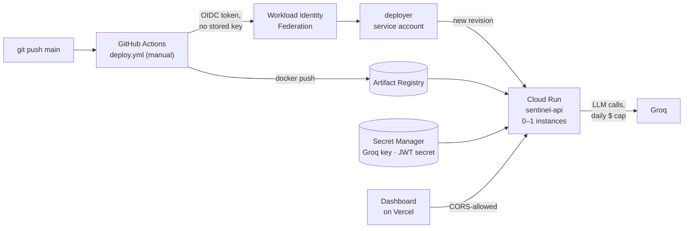

# Deploying Sentinel

The API runs on **Google Cloud Run**; the dashboard on **Vercel**. The cloud side is described as code in [`terraform/`](terraform/) and deployed by [`.github/workflows/deploy.yml`](../.github/workflows/deploy.yml).



| Piece | Choice | Why |
|---|---|---|
| Compute | Cloud Run, 2 vCPU / 2 GiB, 0–1 instances, CPU billed only during requests | Scales to zero, so an idle demo costs nothing; streams SSE natively |
| Image | Built in CI for `linux/amd64`; models and index baked in | A cold start loads from disk — no downloads, no API calls |
| Secrets | Secret Manager, read only by the runtime service account | Values never in the repo, the image, or Terraform state |
| Deploy auth | GitHub OIDC → Workload Identity Federation | No long-lived key exists; only this repo's `main` can deploy |
| Spend | daily LLM cap in the app (`$0.10` default), per-IP rate limit (`6/minute;60/day`), one instance | A public endpoint can't spend more than the owner allows |
| Cost alert | optional billing budget at 50 / 90 / 100% | A second line of defence |

**What it costs:** Cloud Run's free tier covers demo traffic, and an idle service costs nothing. Artifact Registry keeps the 3 newest images (~cents a month). Groq is about $0.001 per question, stopped by the daily cap.

---

## One-time setup

You need a Google Cloud account with billing enabled (new accounts get free credit), the [`gcloud` CLI](https://cloud.google.com/sdk/docs/install), and [Terraform](https://developer.hashicorp.com/terraform/install) ≥ 1.6.

**1. Sign in and create a project**

```bash
gcloud auth login
gcloud auth application-default login            # credentials Terraform uses
gcloud projects create sentinel-<something-unique>
gcloud billing accounts list                     # note the ACCOUNT_ID
gcloud billing projects link sentinel-<something-unique> --billing-account=<ACCOUNT_ID>
gcloud config set project sentinel-<something-unique>
```

**2. Create the secrets (empty), then fill them**

```bash
cd deploy/terraform
cp terraform.tfvars.example terraform.tfvars     # set project_id
terraform init
terraform apply -target=google_project_service.apis -target=google_secret_manager_secret.app
```

Use a **separate Groq key** for the deployment, so it can be revoked without touching CI. Neither command prints the value:

```bash
read -rs GROQ_KEY && printf '%s' "$GROQ_KEY" | gcloud secrets versions add sentinel-groq-api-key --data-file=- && unset GROQ_KEY
openssl rand -hex 32 | tr -d '\n' | gcloud secrets versions add sentinel-jwt-secret --data-file=-
```

**3. Create everything else**

```bash
terraform apply
terraform output github_variables
```

**4. Give GitHub Actions the four variables** (they're identifiers, not secrets)

```bash
gh variable set GCP_PROJECT_ID   --body "<from the output>"
gh variable set GCP_REGION       --body "<from the output>"
gh variable set GCP_WIF_PROVIDER --body "<from the output>"
gh variable set GCP_DEPLOYER_SA  --body "<from the output>"
```

**5. Deploy**

```bash
gh workflow run deploy.yml --ref main
gh run watch                                      # ~10–15 min the first time, faster after
```

The run's summary shows the service URL; `curl <URL>/healthz` should return `{"status":"ok"}`.

**6. The dashboard on Vercel**

Import the repository on [vercel.com/new](https://vercel.com/new), set **Root Directory** to `dashboard`, and add the environment variable `NEXT_PUBLIC_API_URL` = the service URL. Then let the dashboard call the API:

```hcl
# terraform.tfvars
cors_origins = ["https://<your-dashboard>.vercel.app"]
```

```bash
terraform apply
```

---

## Operating it

| Task | How |
|---|---|
| Ship a new version | `gh workflow run deploy.yml --ref main` |
| Logs | `gcloud run services logs read sentinel-api --region <region>` (structured JSON, one line per query) |
| Change the daily cap or rate limit | edit `daily_spend_limit_usd` / `rate_limit` in `terraform.tfvars`, `terraform apply` |
| Rotate the Groq key | add a new secret version; the next revision picks up `latest` |
| Take it offline | `terraform destroy` |

**Limits, stated plainly:** the daily cap is counted per instance and resets when an instance starts, so with scale-to-zero it bounds each waking period, not strictly the day — the Groq account's own spend limit is the hard backstop. The demo account's password is public (the dashboard signs in with it); the JWT demonstrates scoped auth, while the rate limit and spend cap are what protect the endpoint. A cold start takes ~30–60 s while the models load.
