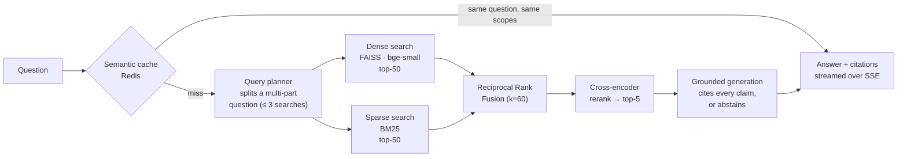
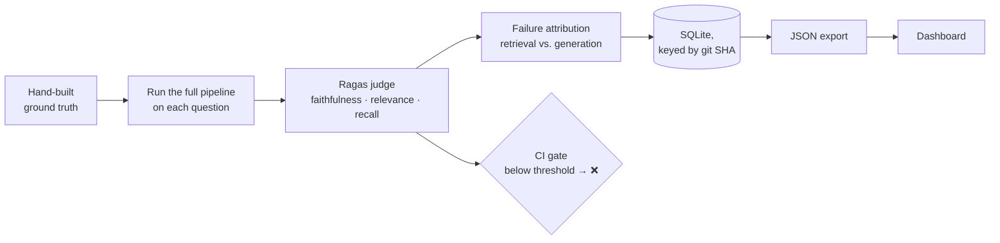

# Design

[← README](../README.md) · [Results](results.md) · [Guardrails](guardrails.md) · [Design](design.md) · [Development](development.md)

How Sentinel works, why it's built the way it is, and what it doesn't do. The system as built, component by component, is in [ARCHITECTURE.md](../ARCHITECTURE.md).

## How it works

### How a query flows

Each stage is timed on its own, so latency is reported per stage, never blended.

### How an answer gets judged

### The pieces

| Component | What it does |
|---|---|
| **Corpus** | 48 current RFCs — HTTP, URIs, TLS 1.3, QUIC, TCP, DNS, cookies, WebSocket, OAuth, JOSE — in 16 clusters → **2,888 chunks** ([manifest](../data/corpus_manifest.json)) |
| **[Ingestion](../sentinel/ingest.py)** | clean → chunk (512 tokens, 12% overlap) → embed locally → FAISS **and** BM25 over the same chunk ids; idempotent, and incremental: only new or changed RFCs are chunked, screened and embedded |
| **[Retrieval](../sentinel/retrieve.py)** | dense + BM25 → RRF → cross-encoder; every chunk carries all four scores, so you can see *why* it was chosen. Dense search runs in FAISS, or in Postgres with [pgvector](../sentinel/vectorstore.py) behind one setting |
| **[Query planning](../sentinel/plan.py)** | splits a multi-part question into up to 3 searches that share one rerank budget; a question it doesn't split takes the ordinary path, and a planner failure falls back to it |
| **[Semantic cache](../sentinel/cache.py)** | a repeated or reworded question in the same scopes and settings reuses the earlier answer; needs identical technical terms and similarity ≥ 0.98. In memory, or in Redis behind one setting |
| **[Generation](../sentinel/generate.py)** | answers only from the passages, cites each claim (`[rfc9110#0007]`), abstains with a fixed sentence when the context is thin |
| **[API](../sentinel/serve.py)** | FastAPI: `POST /token` → JWT, `POST /query` → SSE stream (`retrieved` → `checking` → `token`… → `done`), `POST /feedback` → a thumbs up/down on one answer, `GET /me`; rate limited per account (per IP for the demo account and sign-in) |
| **[Evaluation](../sentinel/eval/)** | Ragas over 48 hand-verified triples, checkpointed per item to SQLite by git SHA, so interrupted runs resume |
| **[CI gates](../.github/workflows/eval-gate.yml)** | lint · tests · faithfulness gate · injection gate, path-filtered and spend-capped; weekly Dependabot bumps run the tests, not the paid gates |
| **[Dashboard](../dashboard/)** | Next.js: trends, drill-down, attribution, live playground, guardrails — from exported JSON, no backend |

<b>Why this corpus</b>

- **Full of exact tokens** — status codes (`429`), header names (`Sec-WebSocket-Key`), error codes (`invalid_grant`). That's where pure semantic search fails, so it's an honest test of hybrid retrieval.
- **Mostly current, and honest where it isn't** — the corpus was chosen to avoid replaced RFCs, but standards keep moving. RFC 2818 is obsoleted by RFC 9110 (both in the corpus), and RFC 8446, TLS 1.3, was obsoleted by RFC 9846 after the corpus was fetched. A RAG system quotes such text faithfully and still answers out of date, and no faithfulness check notices. So every citation carries its RFC's standing (`obsoleted_by`, `updated_by`), recorded from the RFC Editor's metadata ([`scripts/fetch_rfc_status.py`](../scripts/fetch_rfc_status.py) → [`data/rfc_status.json`](../data/rfc_status.json)), and the playground flags an outdated source instead of presenting it as current. [`scripts/watch_rfcs.py`](../scripts/watch_rfcs.py) reads the RFC Editor's index for what has moved since (a corpus RFC newly replaced or amended, new RFCs from the corpus's working groups) and reports it for a decision; the `corpus-watch` workflow runs it in CI.
- **Cleanly licensed** — the IETF Trust permits verbatim reproduction.

<b>Why hybrid retrieval, concretely</b>

Ask *"How is a JWS Compact Serialization structured?"* Dense search misses the defining passage of RFC 7515. BM25 finds it at rank 5 by the exact term; fusion lifts it to 4; the reranker puts it **first**.

It isn't a cure-all: for *"What does `invalid_grant` mean?"* the reranker drops the right passage from rank 4, and the eval correctly flags a retrieval failure.

<b>Why LangChain — and where not</b>

Retriever composition is solved plumbing, so the dense and sparse stages are LangChain `BaseRetriever`s composed with a real `EnsembleRetriever`. The served path computes RRF itself, because `EnsembleRetriever` hides the per-retriever scores that failure attribution needs. More in [ARCHITECTURE.md](../ARCHITECTURE.md#7-where-langchain-is-used-and-where-it-isnt).

<b>How evaluation stays honest</b>

- **Ground truth is hand-written**, verified against the RFC text, never synthetic ([audit](../data/ground_truth_audit.md)).
- **Failure attribution:** low context recall → retrieval failure; good recall but a weak answer → generation failure.
- **Abstentions score as faithful** — they make no claim — while their low relevance still shows. Otherwise the gate would reward confident guessing.
- **The judge is never the generator**, so it doesn't grade its own output.
- **Built for rate-limited APIs:** honours `retry-after`, times out hung items, and stops at a daily quota instead of retrying into it.

---

## Engineering decisions

- **Measure, then decide.** Pool size, CPU vs GPU, the judge and every detector were chosen from measurements kept in the repo.
- **CPU over the Mac GPU.** MPS memory grew until long runs died; CPU rerank p95 was 1.0 s vs 1.9 s. (It then exposed a FAISS/PyTorch OpenMP segfault, fixed by loading PyTorch first.)
- **Taming reasoning models.** `gpt-oss` at default effort sometimes "thought" until it returned nothing; low effort and an explicit output cap fixed both that and truncated judge verdicts.
- **Provider-agnostic, judge pinned.** Groq, OpenAI, DeepSeek, NVIDIA and Google are wired; the judge stays on the host it was calibrated on.
- **pgvector, measured against FAISS before anything relies on it.** `SENTINEL_VECTOR_STORE=pgvector` moves dense search into Postgres: one SQL query with the scope and quarantine filters in its `WHERE` clause, so a blocked chunk still can't take a candidate slot. FAISS's flat index is exact and pgvector's HNSW index isn't, so [`scripts/compare_vector_stores.py`](../scripts/compare_vector_stores.py) compares them on every question ([results](../data/vector_store_comparison.json)):
  - **Top results:** the hybrid top-5 is identical on all 48 questions, with the same hit@5 0.896, recall@5 0.816 and MRR 0.759.
  - **Dense top-50:** the lists overlap 99.7% (96% at worst).
  - **Filters:** on the 50 attack questions, where the filters reject exactly the chunks the questions pull in, not one excluded chunk came back, and every result list was full.
  - **Speed:** 0.9 ms per dense query against 0.1 ms in memory, beside a 10 ms retrieve stage and ~1 s of reranking.

  The index directory stays the source of truth. A sync writes only rows whose text or vector changed, and the service refuses to start on a collection from a different build. Production stays on FAISS: a managed Postgres would be the project's first standing cost, for 4.4 MB of vectors.
- **Spend is metered and capped.** Every Groq call is priced from the tokens the API reports; each CI gate stops at $0.25 and reports its cost ([`spend.py`](../sentinel/spend.py)).
- **Partial evals mislead.** Throttled runs hid a whole class of retrieval failures that a complete run surfaced.
- **The logs are the telemetry.** Each request logs its per-stage timings, when the first word reached the reader, the whole request time, and what its own Groq calls cost (a per-request tally, so concurrent requests don't blur together). [`scripts/ops_report.py`](../scripts/ops_report.py) reads them back from Cloud Logging into [`data/ops_report.json`](../data/ops_report.json): outcome rates (answered, abstained, withheld, refused, turned away), p50/p95/p99 per stage, cost per request and reader feedback. The dashboard's **Operations** view shows it. There's no metrics backend or agent, so nothing new to run or pay for; the report holds counts and timings, never questions.
- **Feedback without a database.** The playground's thumbs up/down goes to `POST /feedback`, which only writes a log line keyed by the answer's `answer_id`; every answer is logged under the same id (question and comment PII-scrubbed, and a withheld answer as it was generated). [`scripts/feedback_candidates.py`](../scripts/feedback_candidates.py) joins the two from Cloud Logging and sorts the thumbs-downs by what they suggest: a wrong answer, a retrieval miss (abstained), or a false withhold or refusal. They're leads for review, not labels: a person writes the reference answer before anything enters the ground truth, and the review file is git-ignored because it holds readers' questions. The service stays stateless and adds no infrastructure.

---

## Limitations

Stated plainly:

| | |
|---|---|
| **Scope** | One corpus (IETF RFCs), 48 hand-built questions, one demo tenant. The pipeline is generic; the numbers aren't claimed to transfer. |
| **Accounts** | A file, not a database: accounts are added by the operator (no sign-up, no password reset), and every instance re-reads the same file. Fine for a handful of accounts. The production RFC index holds only `public` chunks, so a named account's extra scopes have nothing more to retrieve there yet. |
| **Multi-part questions** | Planning is measured on 16 two-part questions that Claude drafted and reviewed, with no person's review. It still covers every part of only 7 of them, and its gate run is a single run. |
| **Semantic cache** | Lives in Upstash's free tier, a third-party service; if it's unreachable the cache fails open and every answer is generated fresh. A hit from Redis takes ~0.2 s longer than from memory, and where that time goes isn't isolated yet. A cold start still takes about a minute while the models load; the cache can't shorten that. The threshold comes from 61 pairs written by Claude; a near-miss closer than "the client's vs the server's certificate" would get through. Casual lower-case phrasings ("what does http 429 mean") always miss. |
| **The judge** | A model, calibrated against one labeller (blind r = +0.78). Judged context recall is too coarse to tell fusion from reranking. |
| **The CI gate** | Sees 24 of 48 questions, faithfulness only. The baseline comes from 4 runs, so about 1 healthy PR in 40 may fail by chance; regressions under ~0.07 pass. Refresh the baseline when main changes generation on purpose. |
| **Attack sets** | The 85 hand-written attacks share an author with the defences; BIPIA showed the bias — screening caught 59% of its attacks vs 93% of our dev and held-out ones. A second policy now catches 74 / 75, but it was written because of that result, so BIPIA is no longer a fully independent test of screening. |
| **Screening** | Can still be written around: 6 of 10 adaptive attacks pass it. The detectors wrongly flag 3 of 2,888 real chunks; those are released by hand-reviewed exceptions, so a new false flag stays quarantined until someone reads it. |
| **Backup layers** | Still let 2% through when screening misses — mostly a planted false claim phrased as RFC errata, which no check here can recognise. |
| **Classifiers** | Vary run to run even at temperature 0; every rate is a mean of 3 runs. |
| **Answer check** | Holding the answer until it passes delays the first word by generation plus the check; the words that follow are a paced replay, not live generation. Wrongly withheld 3 of ~600 clean answers. |
| **PII** | Lists named after a working group (`hybi@ietf.org`) still look personal and are redacted. Names are found only in private documents and miss lone first or last names, `Smith, J.` references and names absent from the Wikidata list (`Raj Patel`); only US/UK-style street addresses are found; IP addresses are out of scope. The private set was written before the name detector, but by its author. |
| **Infra** | FAISS in production; pgvector is wired and tested locally and in CI but not deployed. Reranking ~1 s per query on an M3 but 9–14 s on Cloud Run's 2 vCPUs; a paid Groq key for CI. |

