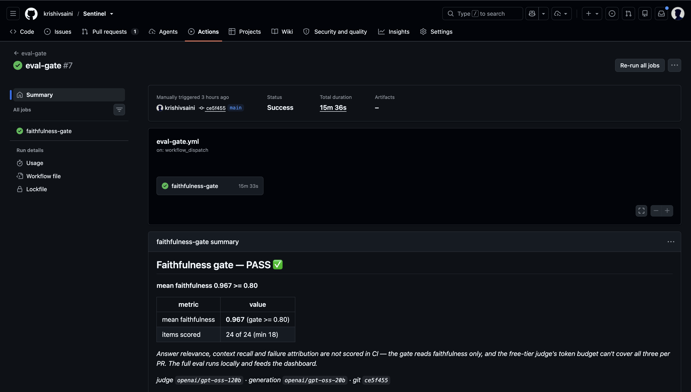
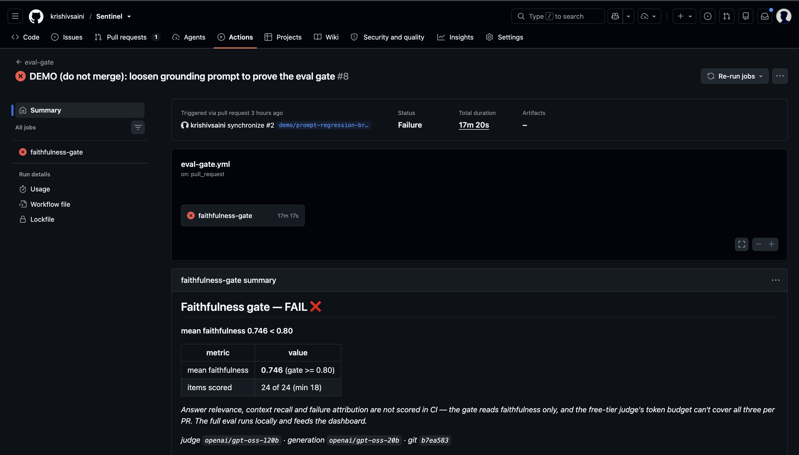

# Results

[← README](../README.md) · [Results](results.md) · [Guardrails](guardrails.md) · [Design](design.md) · [Development](development.md)

Every number here comes from a script in this repo and can be re-run, with sample sizes and the failures shown alongside. The guardrail results are in [guardrails.md](guardrails.md).

## The gate blocks a grounding regression

[PR #2](https://github.com/krishivsaini/Sentinel/pull/2) loosens one thing: the prompt now lets the model answer from its own knowledge.

| Branch | Mean faithfulness | Items scored | Gate (≥ 0.80) |
|---|---|---|---|
| `main` | **0.967** | 24 / 24 | ✅ [pass](https://github.com/krishivsaini/Sentinel/actions/runs/39724557013) |
| PR #2 — loosened grounding prompt | **0.746** | 24 / 24 | ❌ [fail, merge blocked](https://github.com/krishivsaini/Sentinel/actions/runs/39724569826) |

| `main` — gate passes | PR #2 — gate blocks the merge |
|---|---|
|  |  |

Screenshots from before the baseline comparison below was added; a run takes 15–17 minutes over 24 of the 48 questions.

**A fixed line misses subtle regressions**, so the gate also compares each PR with main's own per-question baseline ([4 runs](../data/faithfulness_baseline.json): mean 0.951, SD 0.034). It fails anything more than max(0.05, 2 SD) = **0.068** below, i.e. under 0.883:

| Run | Faithfulness | vs main's baseline | Gate |
|---|---|---|---|
| main, every recorded run | 0.904 – 0.993 | −0.047 at worst | ✅ pass |
| two subtle prompt regressions | 0.865 · 0.855 | −0.086 · −0.096 | ❌ fail — both passed the 0.80 line |
| PR #2 | 0.746 – 0.799 | −0.15 or more | ❌ fail |

The baseline is always read from main, so a PR can't pass by editing it.

## Full evaluation — 48 questions

| Faithfulness | Answer relevance | Context recall | Failure attribution |
|---|---|---|---|
| **0.951** | 0.867 | 0.905 | 42 pass · 3 retrieval · 3 generation |

All three retrieval failures ended in a correct "I don't have enough information", not a guess. Each failure is written up in the [audit](../data/ground_truth_audit.md).

## Does each retrieval stage earn its place?

Gold passages are exact chunk texts, so the first three columns need no judge ([ablation](../scripts/retrieval_ablation.py)).

| Retrieval | Hit@5 | Recall@5 | MRR | Context recall (judge) |
|---|---|---|---|---|
| Dense only | 0.729 | 0.615 | 0.547 | — |
| BM25 only | 0.729 | 0.569 | 0.447 | — |
| Dense + BM25, RRF fusion | 0.833 | 0.708 | 0.572 | 0.904 |
| **+ cross-encoder rerank** (shipped) | **0.896** | **0.816** | **0.759** | 0.898 |

- **Hybrid earns its complexity** — on 6 questions BM25 finds the gold passage and dense search misses it.
- **The reranker earns its latency** — recall@5 +0.11, MRR 0.57 → 0.76 (6 questions rescued, 3 lost).
- **The judged metric can't see it** — Ragas context recall credits *any* supporting passage, which is why the ablation also reports judge-free ranking metrics.

## Multi-part questions

"What port does DNS over TLS use, and which media type must DoH support?" needs passages from two RFCs. A single search's top 5 tends to fill up from whichever half matches best. With query planning on, a small model splits such a question into up to 3 standalone searches ([`plan.py`](../sentinel/plan.py)). Each search is reranked on its share of the same 50-candidate budget, and the results are merged in turn, one from each search. Measured on [16 two-part questions](../data/multistep_questions.jsonl) ([report](../data/multistep_eval.json)):

| | Single search (ships) | Planned |
|---|---|---|
| Parts with a gold passage retrieved | 15 / 32 | **22 / 32** |
| Questions with every part covered | 4 / 16 | **7 / 16** |
| Context recall (judge) | 0.688 | **0.844** |
| Answers that abstained | 6 / 16 | **1 / 16** |
| Faithfulness | 0.956 | 0.958 |
| Retrieve + rerank, p50 | 993 ms | 967 ms, + 288 ms planner call |

- **Not just one more passage:** a split question gets 6 passages, but a single search's top 6 covers the same 15 / 32 parts as its top 5.
- **It rarely splits ordinary questions:** of the 48 single-topic ground-truth questions it split 2 (429 plus its header, and PATCH plus idempotency), and both kept their hit and recall.
- **It isn't free of losses:** on one question the planned search lost the HS256 passage a single search had found (context recall 1.0 → 0.5), and it left 3 of the 16 questions whole.
- **The gold lists are strict:** one to three chunks per part, fixed before the run. Several remaining "misses" retrieved a neighbouring chunk of the right RFC.
- **The set is small and Claude-drafted:** Claude drafted the 16 questions and reference answers from the RFC text, then reviewed each claim against the gold passages and cut three that went beyond them. A loader checks each part's verbatim evidence quote, and that its gold list holds every chunk containing the quote (chunks overlap). No person has reviewed them.
- **Fewer abstentions, not more faithful answers:** faithfulness is level. On the TCP/QUIC question the planned answer stopped abstaining, but part of it went beyond its passages (faithfulness 0.67).
- **Three answers re-judged:** after the review, those three items' answers were generated and judged again, since generation varies between runs.
- **What it cost:** the eval runs cost $0.090 in total.

**It's on by default.** The injection gate was run with planning on, and it passed: 0 / 50 poisoned-document attacks and 0 / 35 attacks in the question got through with the input guard ([results](../data/guardrails/gate_with_planning.json); one run, against 0 / 50 and 1.33 / 35 without planning, so read it as no worse, not better). The planner sees only questions that passed the input guard, and it can only choose search queries. Each question costs one extra `gpt-oss-20b` call (~$0.0001, ~0.3 s). The faithfulness eval and the injection gate retrieve the same way the service does. `SENTINEL_QUERY_PLANNING=false` turns it off.

## Repeated questions: a semantic cache

A question asked again, or reworded, can reuse the earlier answer: no retrieval, reranking (~10 s on Cloud Run), generation or answer check, and no Groq cost beyond the input guard ([`cache.py`](../sentinel/cache.py)). The risk is a **false hit**: "What does 307 mean?" sits right next to "What does 308 mean?" in embedding space, and serving one's answer to the other is a confident, cited wrong answer. So a hit needs two things:

1. **The same exact terms:** status codes, RFC and version numbers, header and parameter names, error codes, ALL-CAPS keywords. Any difference is a miss.
2. **Embedding similarity of at least 0.98:** for questions that differ only in ordinary words ("the client's certificate" vs "the server's").

Measured locally on [32 paraphrases and 29 near-misses](../data/cache_pairs.jsonl) of ground-truth questions, plus all 1,128 pairs of distinct ground-truth questions ([`scripts/cache_eval.py`](../scripts/cache_eval.py), [results](../data/cache_eval.json)):

| Similarity threshold | Paraphrases that hit | Near-miss false hits (tokens + embedding) | Near-miss false hits (embedding only) |
|---|---|---|---|
| 0.92 | 32 / 32 | 3 / 29 | 7 / 29 |
| 0.96 | 27 / 32 | 1 / 29 | 4 / 29 |
| 0.97 | 23 / 32 | 0 / 29 | 2 / 29 |
| **0.98 (ships)** | **18 / 32** | **0 / 29** | 0 / 29 |

- **Tokens stop most near-misses:** 23 of the 29 differ in an exact term and are stopped by the token check at any threshold.
- **The rest set the threshold:** the most similar of the other 6 ("the client's certificate" vs "the server's") scores 0.966, so the threshold is that plus a 0.01 margin.
- **Exact repeats always hit,** and the playground's sample questions are exactly that. No pair of distinct ground-truth questions comes close (highest 0.845).

What makes it safe to share:
- **Scoped:** answers are shared only within one context: the caller's scopes, the index build, the models and prompt, and every retrieval and guardrail setting, hashed together. A scope never sees answers built from documents it can't retrieve, and rebuilding the index starts afresh.
- **Guarded:** the input guard runs on every question before the cache is consulted, so a reworded attack doesn't inherit a cached answer.
- **Clean answers only:** only answers that went out clean are stored: cited, not abstained or withheld, nothing removed by the output guard. A question with personal data in it is never stored.
- **Correctable:** a thumbs-down on any copy of an answer evicts it.

**Live on the deployed service**, with the cache in Redis ([`scripts/cache_live_check.py`](../scripts/cache_live_check.py), [results](../data/cache_live_check_redis.json)):

| Question | End to end | Model cost | From the cache? |
|---|---|---|---|
| "What transport port does DNS over TLS (DoT) use by default?" | 19.8 s | $0.00036 | no: retrieved, reranked, generated |
| the same question again | **0.92 s** | **$0.00003** | yes (similarity 1.0) |
| "By default, which transport port does DNS over TLS (DoT) use?" | **1.02 s** | **$0.00003** | yes (similarity 0.996) |
| "What transport port does DNS over **HTTPS (DoH)** use by default?" | 18.2 s | $0.00036 | no: a different exact term, so its own answer |
| the DoT question, 26 minutes later, on a **new instance** after scale-to-zero | 0.63 s in the service | **$0.00004** | yes: the answer the previous instance generated |

A hit still pays for the input guard, which runs before the cache on every question. The last row is why the cache lives in Redis: with the in-memory backend, that new instance would have started with an empty cache. Against the in-memory backend the same first four questions took 16.4 s, 0.61 s, 0.58 s and 13.8 s ([results](../data/cache_live_check.json)).

Entries last 24 hours, in one of two backends behind one setting, both held to the same tests (every cache and service test in [`test_cache.py`](../tests/test_cache.py) runs against each):

| `SENTINEL_CACHE_BACKEND` | Where entries live | Trade-off |
|---|---|---|
| `memory` (default) | the instance's memory | nothing to run; emptied by every restart, and Cloud Run scales to zero when idle, so every cold start begins with an empty cache |
| `redis` (production) | Redis: a free Upstash database in the API's region | kept across restarts and cold starts, shared by every instance; one more service to run, and ~0.2 s more per hit than memory |

The Redis layout makes the exact-term check a key, not a search: entries are bucketed by context and their exact technical tokens, so a lookup reads one bucket (usually zero to a few entries) and compares those vectors with numpy. No vector index or Redis module is needed, so any Redis works (open-source Redis, Valkey, Redis Cloud, Upstash). Every key has a TTL, so Redis reclaims memory itself. If Redis is unreachable the cache fails open: a lookup is a miss and a store is skipped, so it can't fail a request. Measured in Redis 8.8 with the 48 ground-truth questions, an entry takes about 16.5 KB with its keys, mostly the five retrieved passages a replay returns, so the default 2,000 entries need about 33 MB (a 30 MB free tier needs `SENTINEL_CACHE_MAX_ENTRIES` below about 1,800).

## Is the judge trustworthy?

`gpt-oss-120b` on Groq, compared with hand labels — the second time with every judge score hidden:

| Labels | n | Pearson r | Spearman ρ | Mean abs. error |
|---|---|---|---|---|
| Original (judge score visible) | 18 | +0.90 | +0.98 | 0.047 |
| **Blind** | 27 | **+0.78** | **+0.80** | **0.065** |

The same model served by NVIDIA scored r = +0.69 on the blind set; OpenAI's `gpt-6-luna` ≈ +0.50. Calibration is host-specific, so the judge's host is pinned.

## Latency, per stage

Apple M3, 8 GB, local models on CPU; generation on Groq `gpt-oss-20b` ([report](../data/latency_report.json)).

| Stage | Samples | p50 | p95 | p99 |
|---|---|---|---|---|
| Retrieve — dense + BM25 + RRF | 200 | 10.5 ms | 13.7 ms | 19.0 ms |
| Rerank — cross-encoder over 50 candidates | 200 | 954 ms | 1,021 ms | 1,129 ms |
| Generate — full streamed answer | 50 | 1,047 ms | 2,457 ms | 4,273 ms |

Live on Cloud Run's 2 vCPUs it is much slower: over the first 7 logged requests reranking took **10.6 s p50, 14.0 s p95**, generation 0.7 s and the guards 0.5 s ([ops report](../data/ops_report.json)). A semantic-cache hit skips all of it and returns in 0.5–0.6 s inside the service with the cache in Redis ([live check](../data/cache_live_check_redis.json)).

Reranking is the bottleneck. A [measured sweep](../data/rerank_pool_sweep.json) shows a 20-candidate pool keeps hit@5 at 0.896 and recall@5 at 0.812 (vs 0.816) for **2.6× less rerank time**, but changes the top-5 for 13 of 48 questions. The pool stays at 50 — every number here is measured on it — and 20 is the fallback.

